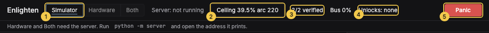
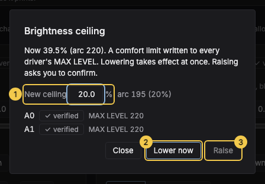
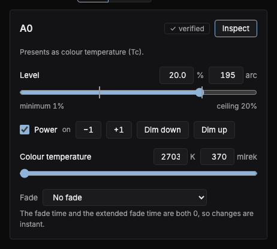
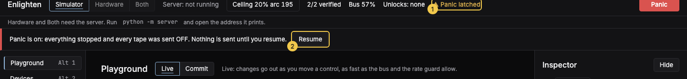

# The ceiling and panic

Start here, before any light is made. Two controls are worth having in your hands first: the one that limits how bright anything can get, and the one that turns everything off.

## Why these two first

The tapes on the bench are bright enough to be unpleasant in a small room, and a wrong command can ask for full output. The brightness ceiling makes that mistake harmless: whatever is asked for, nothing goes above it.

Panic is for everything else. A script that does something you did not expect, an effect that is more than you wanted, a moment of doubt: panic stops all of it and turns every light off, and nothing in the app can delay it.



Both are in the top bar on every page. The ceiling (2) shows its value as output and as an arc level. Panic (5) is never covered by a dialog or by the console.

## Set the ceiling

The app starts with the ceiling at 40%, which it stores as arc level 220. That is 39.5% of output: the ceiling is always rounded down to a level the driver can hold.

1. Choose the Ceiling button in the top bar.
2. Type a new value, such as 20, and press Enter. The dialog shows the arc level it will use.
3. Choose Lower now.



Lowering happens at once, with no question asked, because lowering is always the safe direction. Three things follow: the governor holds every later command to the new value, the app writes it to each driver as MAX LEVEL and reads it back, and a tape that is above it is turned down.

Raising is deliberate. Choose Raise and the app asks you to type the new value before it does anything. A script, a sequence, an effect, a switch and an imported file cannot raise the ceiling at all.

The same from the console:

```console
cap
cap 20%
```

## See it hold

Ask for more than the ceiling allows:

```console
level 0 100%
```

The reply says what happened: the level was sent as the ceiling, and the line is marked `clamped`. The tape is at the ceiling, not at full.



The driver holds the ceiling too. The app wrote it as MAX LEVEL, so a command from somewhere else on the bus is limited by the driver itself. That is why the top bar counts verified drivers (3): a driver is verified when the value it stores has been read back and matches.

> [!NOTE] What the ceiling is not
> The ceiling is a comfort limit. The safety control is the rate guard, which limits how fast light may change. The ceiling can be raised by a deliberate action, and a RESET removes it from a driver, which is why RESET is blocked unless you unlock it.

## Panic, and coming back

There are three ways to panic, and all do the same thing.

| Way                                | When it is the one to use                             |
| ---------------------------------- | ----------------------------------------------------- |
| The Panic button                   | The mouse is in your hand                             |
| Escape, twice within half a second | Your hands are on the keyboard, wherever the focus is |
| `panic` in the console             | You are already typing                                |

Try it now, with the light on from the last step. Everything stops, every tape is sent OFF, and the app latches.



While it is latched, nothing is sent: not from the playground, not from the console, not from a script. Choose Resume, or type `resume`, when you are ready. Resuming sends nothing. The tapes stay off until you ask for light again.

> [!WARNING] Untried on hardware (HW-01)
> On hardware the OFF is meant to reach the bus within 100 ms of the key press. That has been measured against a stand-in for the hasseb, not against the real one.

## What to keep from this chapter

- Lower the ceiling freely. Raising it is the step to think about.
- A reply that says `clamped` means the ceiling did its job.
- Escape twice is panic from anywhere. Resume when you are ready.

The reference page [Safety](../reference/safety.md) has every rule in tables.
