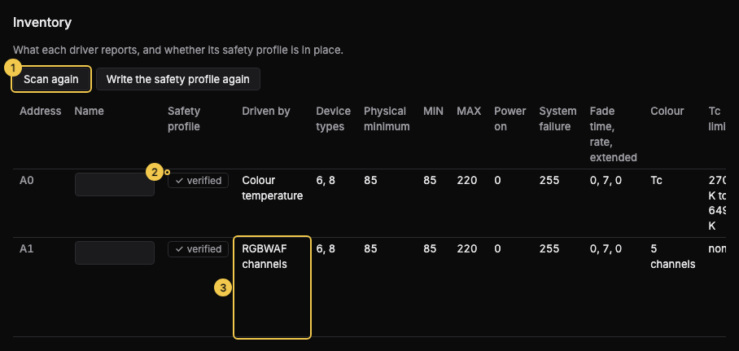
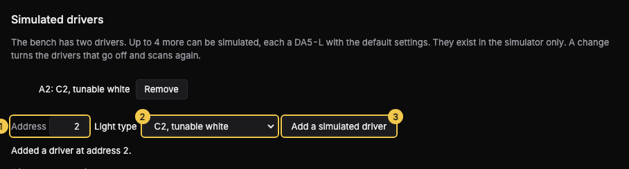
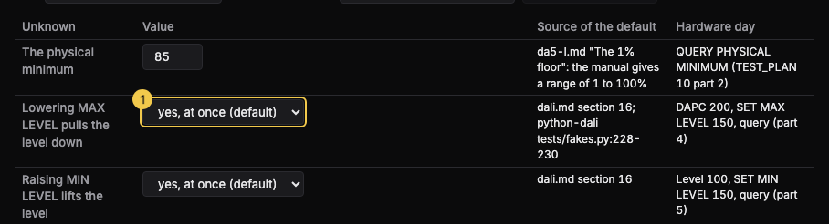

# Drivers, real and simulated

The bench has two drivers and always will. The simulator starts with the same two, and can add more, so a design for a longer hallway can be tried before the hardware exists.

## What a driver tells the app

On the Devices page, the inventory lists what each driver reported when it was scanned. The app does not assume what a driver can do: it asks, and drives it as it answers.



| Column                     | Tells you                                                                               |
| -------------------------- | --------------------------------------------------------------------------------------- |
| Safety profile             | Whether the app's safety values were written and read back (2)                          |
| Driven by                  | Colour temperature, or RGBWAF channels (3). This decides which controls the driver gets |
| Physical minimum, MIN, MAX | How dim it can go, and its own ceiling                                                  |
| Power on, System failure   | What it does when power returns, and when the bus fails                                 |
| Fade time, rate, extended  | The fades it has stored                                                                 |

Give a driver a name in the Name column and the console will take that name in place of the address.

```console
devices
query 0
```

"Scan again" (1) reads everything afresh. Use it after anything that changes addresses or groups.

## Add a driver that does not exist

A design often has more tapes than the bench. The simulator can carry up to four more.

1. On the Devices page, find "Simulated drivers".
2. Give an address from 2 to 63, and a light type: C2 for tunable white, C5 for RGB and two whites.
3. Choose "Add a simulated driver".



The new driver is scanned and given its safety profile like any other, and the top bar counts it. It gets a panel on the Playground, it can be a target for a look, a sequence or an effect, and a mount in the visualiser can follow it.

It exists in the simulator only. On Hardware and Both it is not there: a mount on its address draws unlit and says "simulated only".

## Change how the simulated driver behaves

Some things about the DA5-L are not in its documents: what it does when asked to fade up from off, whether lowering its maximum pulls the light down at once, what colour it starts with. Each of these is a setting under "Simulator settings", with the default the research supports, where that default came from, and the test on the first day with hardware that will settle it.



Changing one rebuilds that driver, switched off, then scans it and writes its profile again. These settings shape the simulated bench and nothing else. They never reach real gear.

This is where to look when the simulator and the real driver disagree: find the setting that matches what the driver did, change it, and the simulator follows.

## Why it is built this way

A simulator that guessed would be pleasant and wrong. This one states each thing it does not know, so that a design made on it is a design made on stated assumptions, and each assumption has a test waiting for it.

## What to keep from this chapter

- The app drives each driver as that driver reports itself.
- Up to four more drivers can be simulated, at addresses 2 to 63.
- Every unknown about the DA5-L is a setting with a source, not a guess buried in code.
