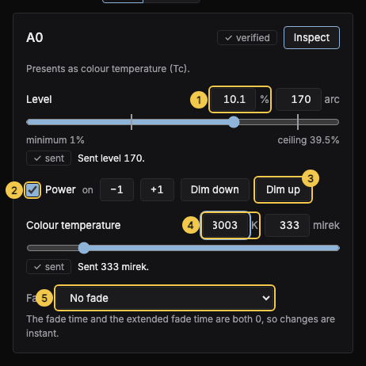
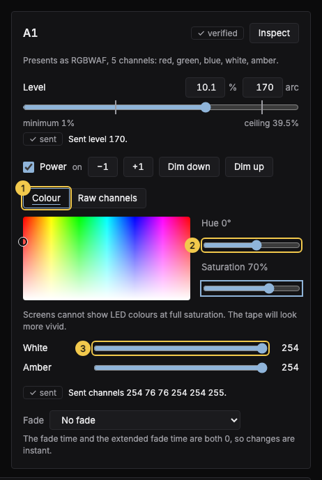
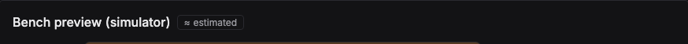

# Levels and colour

The Playground is where you try things by hand. Each driver has a panel with the controls it can take.

## A level



The level control (1) shows two numbers, and you can type either: output %, which is how much light as a share of full, and the arc level, 0 to 254, which is what DALI sends.

They are not in step, on purpose. DALI spaces its 254 levels so that each step looks about the same to the eye, which puts most of them at the dim end: arc level 127 is only 3% of full output, and 220 is about 40%. Thinking in % is natural. Seeing the arc level tells you what the driver was asked for.

The slider has two marks: the driver's minimum, below which it cannot dim, and the ceiling.

```console
level 0 30%
level 0 170
query 0 level
```

Under the control, a line says what was sent. If the value was clamped to the ceiling or refused, it says that too, with the reason.

## On, off and nudging

| Control              | Does                                      |
| -------------------- | ----------------------------------------- |
| Power (2)            | Off, and back to the level it had         |
| -1, +1               | One arc level, the smallest step there is |
| Dim down, Dim up (3) | Dims for as long as you hold it           |

Power coming back to the last level is the driver's doing, not the app's: the driver remembers.

## Live or Commit

At the top of the Playground:

| Mode   | Behaviour                      | Use it when                                                                                |
| ------ | ------------------------------ | ------------------------------------------------------------------------------------------ |
| Live   | A control sends as you move it | Exploring                                                                                  |
| Commit | Nothing is sent until Apply    | You want level and colour to arrive together, or to set things up before any light changes |

In Live mode the app sends the newest value as fast as the bus and the rate guard allow, in a way that makes the driver dim smoothly between values.

## Colour temperature

Tape A is tunable white. Its colour control (4) is a colour temperature, shown in kelvin and in mirek.

|        | Warm | Cool |
| ------ | ---- | ---- |
| Kelvin | 2700 | 6500 |
| Mirek  | 370  | 154  |

Mirek is a million divided by kelvin. DALI works in mirek, and equal steps in mirek look more even than equal steps in kelvin, which is why both are shown. The slider stops at the driver's own limits.

```console
tc 0 2700K
tc 0 4000K 30%
```

The second line sets colour and level together.

## Colour

Tape B has red, green and blue, and two whites. Its panel has a colour picker.



| Control          | Does                                                             |
| ---------------- | ---------------------------------------------------------------- |
| Colour (1)       | Hue and saturation, in the picker or the sliders (2)             |
| White, Amber (3) | The two white channels. On this tape "amber" is the second white |
| Raw channels     | Each channel as a number from 0 to 254                           |

```console
level 1 20%
rgb 1 200 60 0
rgb 1 #204060 w 30
```

`rgb` sets the colour and leaves the level alone, so put some light on first.

A screen cannot show LED colours at full saturation. The real tape will look more vivid than the picker.

The ceiling counts colour too. For this driver, the level times the sum of the channels is held to the ceiling, so five channels at full do not add up to five times the light.

## Colour first, then level

A colour change in DALI has two parts: load the new colour, then bring it in. The app does this for you, and in an order that avoids a wrong-coloured flash: when the light is off or getting brighter the colour goes first, and when it is getting dimmer the level goes first.

To see the parts:

```console
explain tc 0 3000K 30%
```

## The bench preview

At the foot of the page, both tapes are drawn on one scale, with level and colour as the simulator has them.



It is an estimate. Its use is to see at a glance that the right tape did the right thing.

## What to keep from this chapter

- Type a level as % or as an arc level. The two are not in step.
- Commit mode makes several changes arrive as one.
- The line under a control tells you what was sent, not what was asked for.
