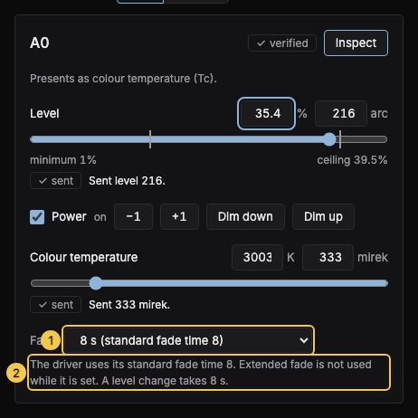

# Fades

A fade is what makes a change of light feel like lighting and not like a switch. In DALI the driver does the fading: the app says "go to this level", and the driver takes the time it has been told to take. That matters, because a fade the driver runs is smooth and needs nothing from the computer while it runs.

## The fade belongs to the driver

Each driver stores one fade setting, and uses it for every level it is sent until the setting is changed. A fade is not part of a level command.



Choose a fade in a driver's panel (1), then change the level. The tape moves over that time, and the bench preview says "fading".


```console
fade 0 2s
level 0 30%
fade 0
```

`fade 0` with no value shows what the driver holds.

## The times a driver has

A driver cannot fade over any time you like. It has two sets of values.

| Set                | Values                                                                  | Notes                                         |
| ------------------ | ----------------------------------------------------------------------- | --------------------------------------------- |
| Fade time          | 15 steps from 0.7 s to 90.5 s, each about 1.4 times the last            | The original DALI fades                       |
| Extended fade time | 0.1 to 1.6 s in tenths, 1 to 16 s, 10 to 160 s in tens, 1 to 16 minutes | Newer, and used only while the fade time is 0 |

The picker lists both, and the line under it (2) says which the driver will use and why. Ask for a time it does not have and the app picks the nearest and tells you:

```console
fade 0 5s
```

There are gaps. Above 160 seconds the steps are whole minutes, so nothing lies between 160 seconds and 3 minutes. A sequence that needs 25 minutes is made of two fades, 16 and 9, which is [the planner's](07-sequences.md) job.

## What fades and what does not

| Command                                         | Fades                                |
| ----------------------------------------------- | ------------------------------------ |
| A level, a scene recall, back to the last level | Over the fade time                   |
| Dim up and dim down, held                       | At the fade rate, a separate setting |
| Off, and a nudge of one step                    | Never. They are instant              |

Off is always instant. To fade to off, send a level of 0 with a fade set:

```console
fade 0 4s
level 0 0
```

## Fades and the rate guard

The rate guard limits fast changes, and a fade is how to stay on its right side. A change over 0.7 seconds or longer is not a hard step, however large it is. A sudden jump from dim to bright is.

If you move a level back and forth quickly with no fade, the app starts to hold your changes and says "waiting" with the reason. Set a fade of a second or more and the same changes go through.

## Why long fades are worth having

A driver can fade for 16 minutes by itself. A night-time rise, a slow wind-down in the evening, a sunrise: each can be one or two commands, after which the driver does the work. If the computer sleeps or the browser tab is suspended mid-fade, the light keeps moving.

> [!WARNING] Untried on hardware (HW-08)
> How the DA5-L fades has not been observed: whether a fade up from off jumps to the minimum first, what a new command does to a fade that is running, and how long each setting takes on the bench. The simulator has a setting for each. Until they are seen on the bench, the app does not rely on fades on hardware at all.

## What to keep from this chapter

- The driver fades, not the app. Set the fade, then send the level.
- A driver has a fixed set of times. The app picks the nearest and says which.
- A fade of 0.7 seconds or more keeps a large change from being a hard step.
