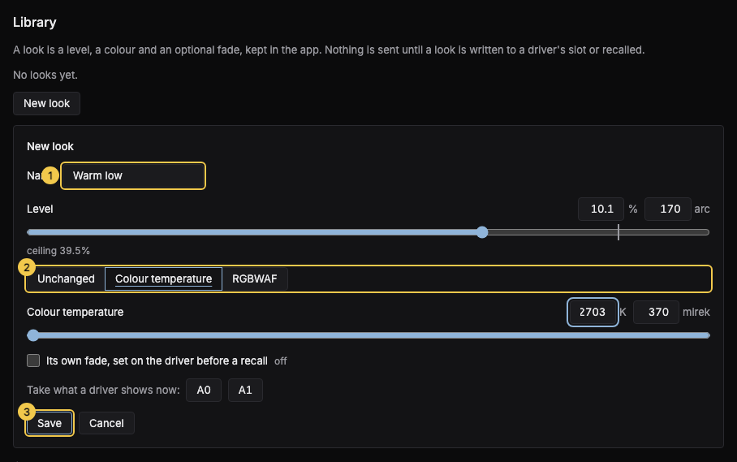
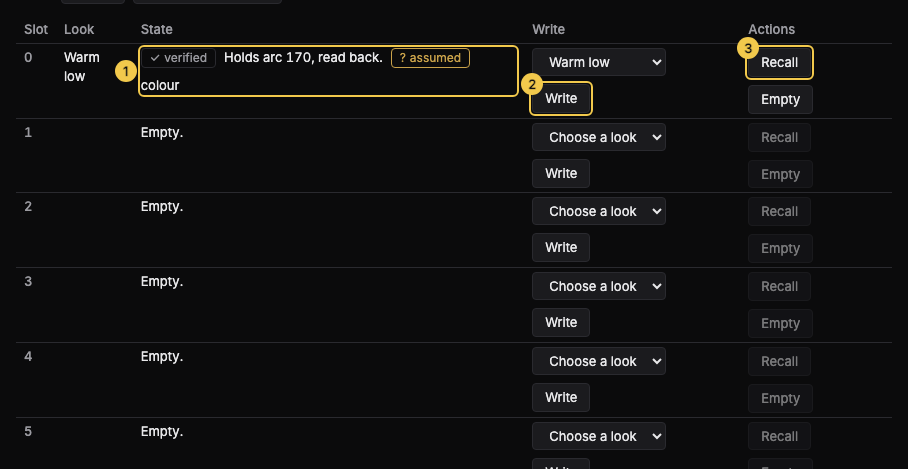

# Looks

A look is a named state of a tape: a level, a colour and, if you want, the fade to arrive with. "Warm low" might be 10% at 2700 K over 2 seconds. Looks are how you keep something you liked in the Playground.

## Make one

1. On the Looks page, choose "New look".
2. Name it, set a level, choose a colour kind and a value. Or use "Take what a driver shows now" to copy the level and colour a driver has, which is how to keep something you liked in the Playground.
3. Save.



Nothing has been sent. A look in the library is a note in the app.

## Put it in a driver

DALI drivers have 16 scene slots each. A slot holds a level, and on a colour driver a colour, inside the driver. Recalling a slot is one short command, and the driver does it without the app knowing what the slot holds. That is how a wall switch in a real house recalls a scene: the switch says "scene 3", and each driver goes to its own scene 3.

1. Under "Slots", choose the driver.
2. In a slot's row, choose the look and "Write".

The app stores the level and colour in the driver and reads the level back. The row then says what the driver holds.



"Recall" (3) sends the driver to it.

```console
scene 0 list
scene 0 recall 0
```

## What the state means

| State                  | Means                                                                                                  |
| ---------------------- | ------------------------------------------------------------------------------------------------------ |
| Holds arc n, read back | The driver's stored level matches the look                                                             |
| assumed                | Said of the colour. A driver gives no way to read a stored colour back, so the app takes it as written |
| mismatch               | The look was changed after it was written, or the driver was written from somewhere else               |

A mismatch is not an error. It is the app telling you that the library and the driver no longer agree, so that you can decide which is right and write again.

## One look, several drivers

A look is not tied to one driver, but its colour has to be of a kind the driver takes: a look with a colour temperature fits tape A, and one with channel levels fits tape B. Write a warm white look to slot 0 of tape A and a matching channel mix to slot 0 of tape B, and "Recall on several drivers" brings both to it with one command. Each driver goes to what its own slot holds.

"On" can be every driver or a group. A group is made in the console: `group 0 add 1` and `group 1 add 1` put both tapes in group 1, and `scan` then brings the app's inventory up to date.

A driver whose slot is empty does not change. That is the standard's rule, and it is useful: a scene can leave some lights alone.

## A look with a fade

If a look has a fade, a recall sets the driver's fade first and then recalls the slot. The fade belongs to the driver, as [the last chapter](05-fades.md) said, so it stays set afterwards.

## Why slots and not just the library

A look in the library needs the app to send it. A look in a slot needs only one short command, two bytes, from anything on the bus. Designing in the library and then writing to slots is how a design made here ends up in drivers that will later be run by wall switches.

## What to keep from this chapter

- A look lives in the app until it is written to a slot.
- Writing reads the level back. The colour is taken as written.
- A recall goes to each driver's own slot. An empty slot changes nothing.
