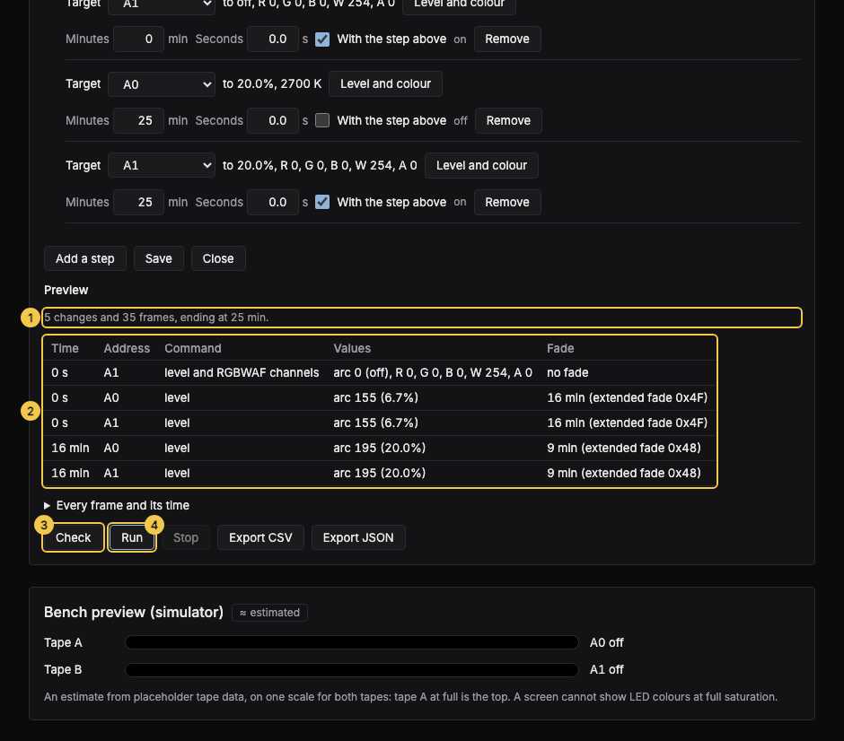

# Sequences

A sequence is lighting over time: go here, then there, each step taking as long as you say. A night-time fade-in over 25 minutes is a sequence. The point of the Sequences page is that you see every command before any of them is sent.

## Open a built-in one

On the Sequences page, choose "Night fade-in". It opens in the editor: tape B is set to warm white while still off, then both tapes rise to 20% at 2700 K over 25 minutes.

## Read the plan

The preview (2) is what will be sent, and when.

| Column          | Says                 |
| --------------- | -------------------- |
| Time            | When, from the start |
| Address         | Which driver         |
| Command, Values | What it is sent      |
| Fade            | The driver fade used |

The fades are the part to read. No driver can fade for 25 minutes, so the planner made the rise from two fades, 16 minutes and 9, with a level in between chosen so that the two together follow the line one long fade would have followed. Five changes, and the drivers do the rest.

"Every frame and its time" opens the list of frames, if you want to see the bus itself.

## Check, then run

"Check" (3) runs the plan on a copy of the simulated bench, with the governor's own code, faster than real time. It reports what would be refused, in the governor's words, and changes nothing.

"Run" (4) starts it. A plan the governor would refuse does not start at all. While it runs, the page shows where it is, and Stop ends it. Panic ends it too.

## Make one

1. "New sequence", and a name.
2. "Add a step": a target, "Level and colour", and a duration.
3. Add more. "With the step above" makes a step start with the one before it.
4. Save.

A step that changes nothing sends nothing. That is how to make a pause: a step to the same level, lasting as long as the pause.

## What the rate guard will not let a sequence do

Try a sequence of steps that go up and down with no time between them, and Check says the governor would refuse it, with the rule. Steps in one direction pass. A sequence is held to the same limits as your hand on a slider. The planner tells you before the run, not during it.

## Long runs and the browser

A sequence leans on the drivers' own fades where it can, so a late step delays the next change and does not distort a fade already running. The page holds a screen wake lock while a sequence runs.

There is a limit to this. If the browser suspends the page, or the computer sleeps, the run's clock stops with it. The report at the end gives the time by the wall clock when the two differ, so you know it happened. For a run that matters, keep the tab in front and the computer awake.

## Take a plan elsewhere

"Export CSV" and "Export JSON" write the plan: one row for each change, with its time, address, command, values and fade. It is the design in a form another system could be given.

## What to keep from this chapter

- The preview is the whole truth of what will be sent.
- Check before Run. A refused plan never starts.
- Long fades are the drivers' work. The app only starts them.
