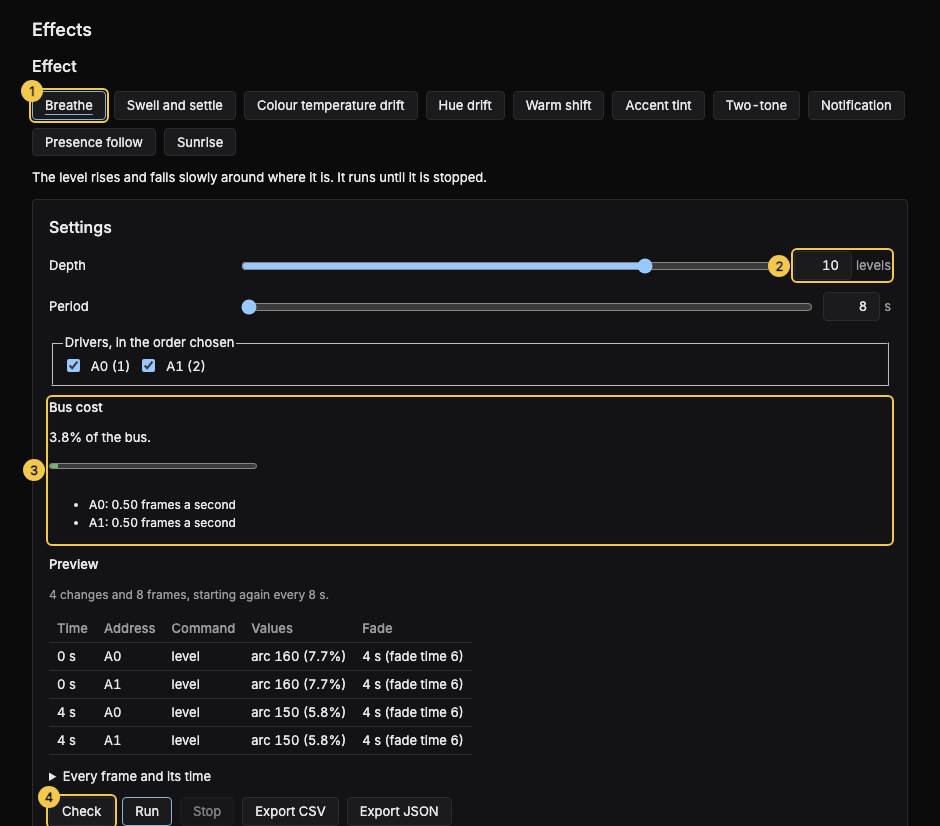

# Effects

An effect is a built-in pattern: a slow breath in the level, a drift in colour temperature, a soft pulse as a notification. There are ten. Each has a few settings, and each is shaped to stay inside what the rate guard allows.

## Try one

An effect moves around the level a light is at, so put some light on first.

```console
level 0 150
level 1 150
```

Then, on the Effects page, choose "Breathe".



| Part         | Says                                                                      |
| ------------ | ------------------------------------------------------------------------- |
| Settings (2) | For Breathe: how many levels up and down, and how long one breath takes   |
| Drivers      | Which drivers take part, and in what order                                |
| Bus cost (3) | The share of the bus the effect uses, and frames a second for each driver |
| Preview      | Every change in one period                                                |

"Check" (4) tries it on a copy of the simulated bench. "Run" starts it. Breathe repeats until you choose Stop.

## Why the sliders are narrow

The settings do not go far: a breath is 4 to 12 levels deep and takes 8 to 16 seconds. That is deliberate. Light that pulses quickly or deeply is the kind that can trigger seizures, and the ranges are the ones inside which the rate guard lets the effect run. What the sliders offer, runs.

The effects were chosen to be the calm kind: slow, shallow, and mostly made of driver fades.

## The ten

| Effect                   | Good for                                                      |
| ------------------------ | ------------------------------------------------------------- |
| Breathe                  | A room that feels alive without drawing the eye               |
| Swell and settle         | Arriving: a brief rise, then ease back                        |
| Colour temperature drift | Tunable white that wanders a little through an evening        |
| Hue drift                | The same, in tint, on an RGB tape                             |
| Warm shift               | Dimming that warms as it goes, as a filament lamp does        |
| Accent tint              | White with a small colour offset                              |
| Two-tone                 | Two tapes breathing in opposite phase, so the room stays even |
| Notification             | One or two soft pulses                                        |
| Presence follow          | Tapes brightening in turn ahead of someone walking past       |
| Sunrise                  | A long rise from off, warm to cooler                          |

[Looks, sequences and effects](../reference/design.md#effects) has every setting and its range.

## Effects need the right driver

Colour temperature drift needs a driver that takes a colour temperature. Hue drift and accent tint need colour channels. Two-tone and presence follow want more than one driver, which is a good reason to [add a simulated one](03-simulated-drivers.md). When an effect cannot run, the page says why in place of the cost.

## The bus cost

DALI is slow: about 30 frames a second at most, shared by everything on the bus. An effect that uses a few percent leaves room for switches and other commands. The cost is shown so that you can see when an effect on many drivers would crowd the bus.

## Keep one

"Save these settings" keeps an effect and its settings under a name. A saved effect can be started from a switch plate.

## What to keep from this chapter

- Put light on first. An effect moves around where the light is.
- The ranges are narrow because the rate guard is strict, and it is strict for a reason.
- Watch the bus cost when an effect goes to many drivers.
