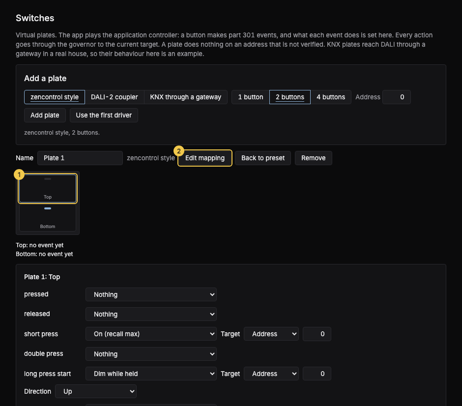

# Switches

In a house, lighting is run from wall plates, not from a computer. The Switches page gives you virtual plates, so you can find out how a design feels under a thumb: a short press, a double press, a hold.

## Add a plate

1. Choose a style and the number of buttons.
2. Give the address of the driver it should aim at, or choose "Use the first driver".
3. "Add plate".

Press the top button (1) and the tape comes on. Hold the bottom one and it dims. The console shows each event the plate made and what it did, and the frames appear in the Bus monitor with the source "switch".

## Events, and what they do

A button does not send "on". It makes events, and a mapping turns events into actions.

| You do                   | The plate makes                           |
| ------------------------ | ----------------------------------------- |
| Press and let go quickly | short press                               |
| Twice, quickly           | double press, if the double timer is on   |
| Hold                     | long press start, then repeats, then stop |
| Hold for a long time     | stuck                                     |

"Edit mapping" (2) shows, for each button, what each event does: on, off, toggle, recall a slot, dim while held, warmer or cooler while held, run a sequence or an effect, stop.

This is where the earlier chapters meet. A double press can recall the slot you wrote in [Looks](06-looks.md). A hold can start a sequence you saved in [Sequences](07-sequences.md). A built-in one has to be opened and saved under a name first.

## Timers are the feel

| Timer  | Changes                                                                                   |
| ------ | ----------------------------------------------------------------------------------------- |
| Short  | How long a press can last and still be short                                              |
| Double | How long the plate waits for a second press. On, it delays every short press by that much |
| Repeat | How fast a hold dims                                                                      |
| Stuck  | When a hold is taken for a jammed button                                                  |

The double timer is the one to think about. Turn it on and every short press waits to see whether a second is coming, which makes the light feel late. That trade is real in every switch system, and here you can feel it before choosing.

## Three styles

The styles follow three families of real plates: a zencontrol style, a generic DALI-2 coupler, and KNX plates that reach DALI through a gateway. They differ in what their buttons are for and how a hold behaves. They are drawn plainly and are examples of behaviour, not copies of products.

## Plates obey the governor

A plate's command goes through the same gate as everything else. A plate aimed at a driver that is not verified does nothing and says why. A hold stops repeating on release, on panic and on a change of target. And a plate cannot raise the ceiling or unlock anything.

## What to keep from this chapter

- A button makes events. A mapping decides what they do.
- The double press timer buys a second gesture at the price of a slower first one.
- A plate can recall a slot, run a sequence or start an effect.
