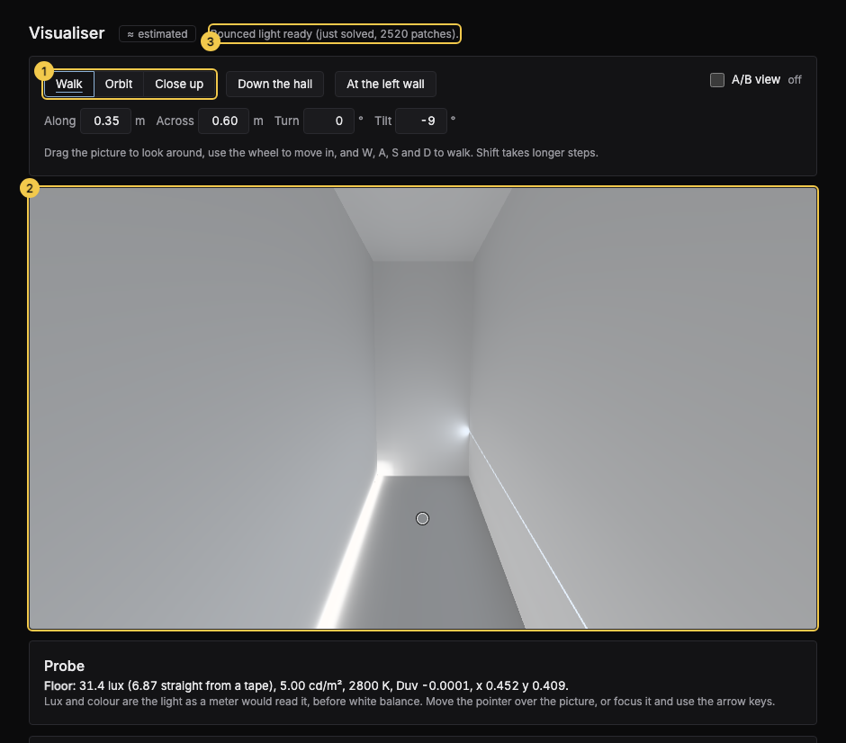
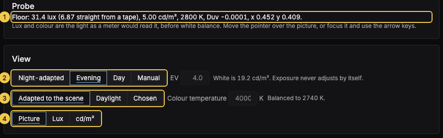
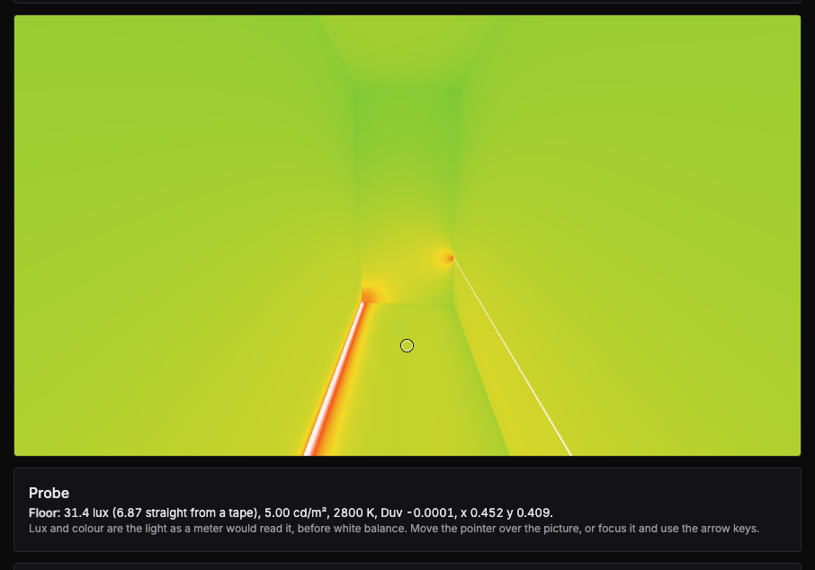
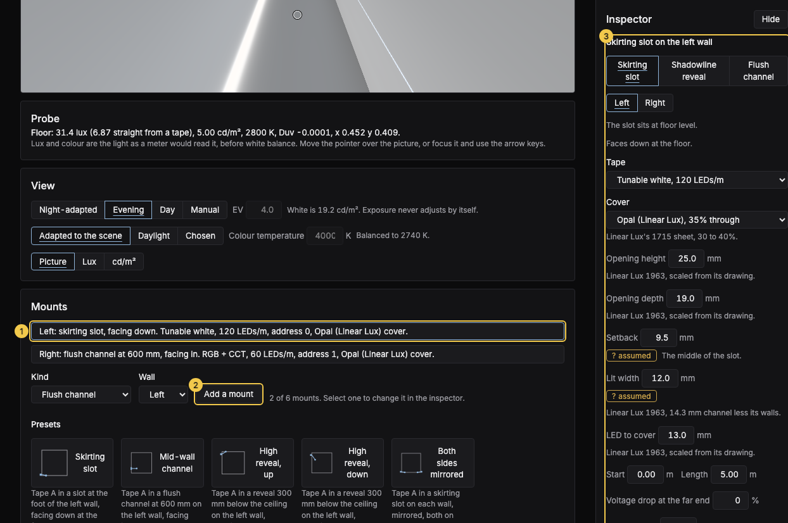

# The visualiser

The bench shows what the tapes do. It does not show what they would do in a hallway, behind a cover, bouncing off a wall. The visualiser draws that: a hallway with the tapes mounted in it, lit by whatever the drivers are doing now.

## What you are looking at



Put some light on, then open the Visualiser.

```console
tc 0 2700K 30%
level 1 20%
```

The hallway starts 5 metres long, with tape A in a slot at the foot of the left wall and tape B in a channel in the right wall at 600 mm. The picture follows the drivers: change a level, and it changes in the next frame.

It is labelled "estimated" for a reason. It works out how light leaves each tape, passes its cover and bounces around the room, and that part is sound. What it starts from is not measured: the tapes' brightness and colour are placeholders, and the walls are taken as plain and matte. Use it to compare, not to specify.

## Look around

| Control                         | Does                                                                |
| ------------------------------- | ------------------------------------------------------------------- |
| Walk (1)                        | Stand in the hallway. Drag to look, W A S D to move                 |
| Orbit                           | See the hallway from outside                                        |
| Close up                        | Look at a mount closely enough to see whether the LEDs show as dots |
| Down the hall, At the left wall | Go to a set view                                                    |

## Read the light

Move the pointer over the picture and the probe reads that point as a meter would: lux, colour temperature, and how much of the light came straight from a tape and not off a wall.



| Control           | Why it is there                                                                                                                                                |
| ----------------- | -------------------------------------------------------------------------------------------------------------------------------------------------------------- |
| Exposure (2)      | Your eye adapts and a picture cannot. Choose the adaptation: night, evening or day. It never changes by itself, so two pictures at one setting can be compared |
| White balance (3) | The same, for colour. "Adapted to the scene" is how the room would look to someone in it                                                                       |
| Lux, cd/m2 (4)    | False colour: the picture as numbers                                                                                                                           |

False colour is the view to trust for brightness. A photograph of a dim room and a bright room can look alike. Their lux does not.



## Move a tape

A mount is a tape in a place. Select one in the list and its settings open in the inspector.



| Change            | To see                                                                      |
| ----------------- | --------------------------------------------------------------------------- |
| Kind              | A slot at the skirting, a reveal near the ceiling, or a channel in the wall |
| Cover             | How much an opal cover costs in light, and what it does to the dots         |
| Tape density      | 60 or 120 LEDs a metre, or COB                                              |
| Height, direction | Where the light lands                                                       |
| DALI address      | Which driver the mount follows                                              |

Each number in the inspector says where it came from: a maker's drawing, or "assumed". The presets under the list replace the mounts with a common arrangement.

There can be up to six mounts. With [a simulated driver](03-simulated-drivers.md) added, a third or fourth tape can have its own address and its own level.

## Compare two set-ups

"A/B view" puts two set-ups side by side, lit by the same drivers at the same exposure. Opal against frosted. A channel at 600 mm against one at 900. The comparison is where an estimate is most useful: the two share every assumption, so the difference between them means more than either picture alone.

## Change the room

Under "Hallway": length, width, height, open or closed ends, and the finish of each surface. A darker floor or a lower ceiling changes how far the light carries, and the picture is solved again in a second or two.

## What to keep from this chapter

- The picture follows the drivers. Change the light anywhere in the app and look here.
- Trust false colour and the probe over the picture for how bright.
- Compare, do not specify. The tape data are placeholders.
