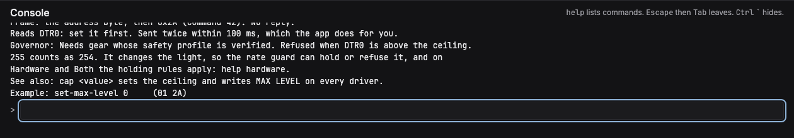
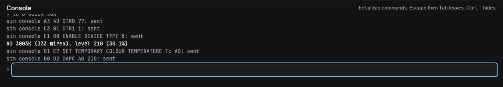

# The console

Everything so far can be done by typing. The console is faster once you know it, it shows exactly what was sent, and it is the only way to send any DALI command by name.

Ctrl ` opens it from anywhere.

## The same ground, typed

| In the app         | In the console                        |
| ------------------ | ------------------------------------- |
| The ceiling dialog | `cap`, `cap 30%`                      |
| A level slider     | `level 0 30%`                         |
| Power              | `off 0`, `on 0`                       |
| Colour temperature | `tc 0 2700K`                          |
| The colour picker  | `rgb 1 200 60 0`                      |
| The fade picker    | `fade 0 2s`                           |
| A slot             | `scene 0 store 3`, `scene 0 recall 3` |
| The inventory      | `devices`, `query 0`                  |
| Panic              | `panic`, `resume`                     |

```console
level 0,1 20%
tc 0 3000K
off all
```

An address can be a list (`0,1`), a range (`0..3`), a group (`g0`), `all`, or a name you gave a driver on the Devices page. `use 0` makes 0 the default, after which you can leave it out.

## Ask it

| Type           | To get                                         |
| -------------- | ---------------------------------------------- |
| `help`         | The commands                                   |
| `help tc`      | One command                                    |
| `help -k fade` | Everything that mentions a word                |
| Tab            | Completion, and a list of what could come next |

```console
help -k scene
help go-to-scene
```

## Two layers

The commands you have used (`level`, `tc`, `fade`) are the app's own. Each is shorthand for one or more standard DALI commands. Underneath, all 137 DALI commands the app supports can be typed by name.

```console
dapc 0 128
query-actual-level 0
recall-min-level 0
```

`help <name>` says what a DALI command does, what frame it is, which registers it uses, and what the governor does with it.



## See what a line sends

`explain` shows the DALI commands a line would send, without sending them.

```console
explain tc 0 3000K 30%
```

Each row is a line you could type yourself, its frames in hex, and its name in the standard. To watch frames as they go, turn the trace on:

```console
trace on
tc 0 3000K 30%
trace off
```



`explain` is the way to learn what the friendly commands are made of. The Bus monitor page keeps the same record for everything, whatever sent it.

One thing `explain` cannot tell you is whether the governor would let the line through. It does say when a level would be clamped to the ceiling. A hold or a refusal shows only when the line is sent.

## Registers, and why some commands come in pairs

Many DALI commands that store a setting take no value of their own. The value goes in a register first, with a command that every driver on the bus hears, and the storing command then reads it.

```console
dtr0 200
set-max-level 0
query-max-level 0
```

The app tracks the registers. If something may have changed one without the app knowing, a command that reads it is refused until you set it again. `help set-max-level` says which register a command reads.

## Editing

The console edits a line as a shell does. Up and Down walk the history, Ctrl-R searches it, and `!!` is the last line again.

| Form     | Is                                   |
| -------- | ------------------------------------ |
| `!!`     | The last line                        |
| `!lev`   | The last line that began with `lev`  |
| `^30^40` | The last line, with 30 changed to 40 |

With verify mode on, a line made this way is shown before it runs. [Keys](../generated/keys.md) has every key.

## When a line is turned away

A refusal says why. [Refusals and messages](../reference/messages.md) lists the common ones with what to do. When the rate guard is only holding a line, the console says `waiting`, and sends it when it may.

## What to keep from this chapter

- `help -k <word>` finds the command. `help <name>` explains it.
- `explain` shows what a line is made of, and sends nothing.
- Every line goes through the governor, typed or not.
