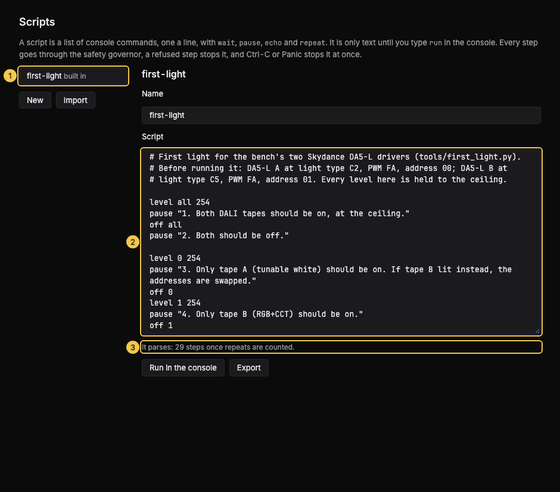

# Scripts

A script is a list of console lines in a file, with a few words of its own for waiting and pausing. It is how to make a check repeatable, or to walk someone else through one.

## Run the built-in one

`first-light` is the check for a newly wired bench: is each tape on the address it should be, are warm and cool the right way round, is each colour channel where it should be.

```console
run first-light
```

It turns something on, tells you what you should see, and waits. Press Enter to go on, or Ctrl-C to stop. Every level in it is held to the ceiling.

## Write one



On the Scripts page, "New", a name, and the text:

```script
# Warm to cool on tape A, slowly.
level 0 20%
tc 0 2700K
pause "Warm. Press Enter for cool."
fade 0 4s
tc 0 5000K
wait 5s
off 0
```

The line under the text (3) says whether it parses, and names each error with its line. Save, then Run.

| Word                 | Does                                  |
| -------------------- | ------------------------------------- |
| `wait 5s`            | Waits                                 |
| `pause "message"`    | Shows the message and waits for Enter |
| `echo text`          | Prints text                           |
| `repeat 3` ... `end` | Repeats the lines between             |
| `#`                  | Starts a comment                      |

Everything else is an ordinary console line.

## A script is checked before it runs

If any line does not parse, nothing runs. If a step is refused while it runs, the script stops there and says which line. It never carries on past a refusal: the steps after it assumed that one happened.

## What a script cannot do

It cannot unlock anything, raise the ceiling, change the target or run another script. These are held back so that a script someone sends you can do no more than you could by typing its lines with nothing unlocked. Importing a script never runs it.

## Scripts and the rate guard

A script that changes the same tape quickly will be held, as you would be. The step waits for the guard, up to 10 seconds, and says so. Put a `wait` between large changes, or a fade on them, and the script runs at the pace you wrote.

```script
repeat 3
  level 0 30%
  wait 3s
  level 0 10%
  wait 3s
end
```

## Scripts or sequences

|                        | Script                                                | Sequence                                                |
| ---------------------- | ----------------------------------------------------- | ------------------------------------------------------- |
| Is                     | Lines, run in order                                   | Steps with durations, planned ahead                     |
| Shows before running   | That it parses                                        | Every change, and whether the governor would refuse any |
| Can pause for a person | Yes                                                   | No                                                      |
| Good for               | Checks, walk-throughs, anything with a question in it | Lighting over time                                      |

## What to keep from this chapter

- A script is console lines, plus `wait`, `pause`, `echo` and `repeat`.
- It is checked whole before it runs, and stops at a refusal.
- It cannot unlock or raise the ceiling, so an imported one is safe to read and run.
