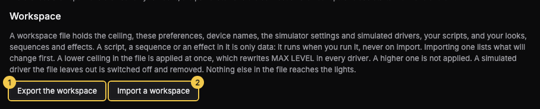

# Saving and moving work

## What is kept, and where

Looks, sequences, effects, scripts, plates, the hallway and its mounts, your preferences and the ceiling are all kept in the browser, on this computer. Nothing is sent anywhere: the app talks to no address but its own.

That has two consequences. Your work is there when you come back, in the same browser. And it is nowhere else until you export it.

## One file for everything

Settings, "Export the workspace", writes one file with all of it.

Export when a design reaches a point worth keeping, and before trying something you might want to undo. The file is plain JSON, so it can sit in a project folder, go into version control, or be sent to someone.

## Bringing a file in

"Import a workspace" reads a file, lists what will change, and waits for you to confirm. Then it replaces the library and the set-up.

An import is careful in one direction only.

| It will                                                                 | It will not              |
| ----------------------------------------------------------------------- | ------------------------ |
| Apply a ceiling lower than yours, at once                               | Raise the ceiling        |
| Turn verify mode on                                                     | Turn it off              |
| Replace looks, sequences, effects and plates, and merge scripts by name | Run any of them          |
| Add and remove simulated drivers to match                               | Write a look to a driver |

A file from someone else is treated as untrusted. It is checked before it is used, and nothing in it runs because it was imported. A script in it is text until you type `run`.

## What does not travel

| Thing                         | Why                                                                                                               |
| ----------------------------- | ----------------------------------------------------------------------------------------------------------------- |
| What is stored in the drivers | Slots, groups and fades are in the drivers. The file has the slot map, which is the app's record of what it wrote |
| Unlocks and the panic latch   | They are for one session, on purpose                                                                              |
| Console history               | It stays in this browser                                                                                          |

After importing on another bench, the slot map says what each slot should hold. The drivers there hold whatever they held. "Read the slots again" on the Looks page shows which slots match, and Write puts right the ones that do not.

## Smaller exports

| From                                      | You get                              |
| ----------------------------------------- | ------------------------------------ |
| Scripts, Export                           | One script, as text                  |
| Sequences and Effects, Export CSV or JSON | The plan: every change with its time |

## A profile for the app

Use a browser profile kept for this app. The browser keys stored data to the address, and the address here is a port on your own machine, so anything else that ever ran on that port in the same profile would share the app's data.

## What to keep from this chapter

- Your work is in this browser until you export it.
- An import can only make the app more careful, never less.
- The drivers' own contents do not travel. The slot map says what to write again.
