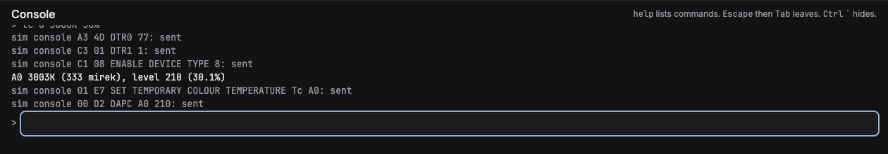

# Console

Ctrl ` opens it. Every command goes through the governor, as every other control does. The full list of commands is in [Console commands](../generated/console-commands.md), and every DALI command in [DALI commands](../generated/dali-commands.md).

## A line

A command name, then arguments separated by spaces. Double quotes group a string. `#` starts a comment. Names are not case-sensitive.

| Form             | Meaning                                             |
| ---------------- | --------------------------------------------------- |
| `0` to `63`      | A short address                                     |
| `g0` to `g15`    | A group                                             |
| `all`            | Broadcast                                           |
| `unaddressed`    | Broadcast to gear without a short address           |
| a name           | An alias set on the Devices page                    |
| `0,1` and `0..3` | A list or a range of short addresses, sent in order |

| Value                  | Meaning                                    |
| ---------------------- | ------------------------------------------ |
| `35%`                  | Output                                     |
| `128`                  | An arc level, or a channel level, 0 to 254 |
| `2700K`, `370m`        | Kelvin, mirek                              |
| `300ms`, `2s`, `25min` | A time                                     |
| `#ff8000`              | A colour, for `rgb`                        |

`use <addr>` sets a default address, after which it may be left out. `use` alone clears it.

## Two kinds of command

| Kind              | Examples                                                                      | What they are                                                                          |
| ----------------- | ----------------------------------------------------------------------------- | -------------------------------------------------------------------------------------- |
| The console's own | `level`, `tc`, `rgb`, `fade`, `scene`, `group`, `query`, `cap`, `scan`, `run` | Shorthand. Most compile to standard DALI frames                                        |
| DALI by name      | `dapc 0 128`, `recall-max-level 0`, `query-actual-level 0`                    | 137 commands of IEC 62386, named as python-dali names them, in lower case with hyphens |

Device type commands get ENABLE DEVICE TYPE added. Commands the standard sends twice go twice. `dt6-` or `dt8-` before a name reaches a device type command that shares its name with another. `raw <hex> <hex> [x2]` sends one frame as given, judged like any other.

## Finding out

| Command           | Gives                                                                                                                 |
| ----------------- | --------------------------------------------------------------------------------------------------------------------- |
| `help`            | The commands                                                                                                          |
| `help <name>`     | One command of either kind, or a topic: `keys`, `addresses`, `values`, `dali`, `hardware`, `scripts`                  |
| `help -k <word>`  | Every command and topic that mentions the word                                                                        |
| `explain <line>`  | What the line would send: each DALI command as a line you could type, its frames in hex and its name. Nothing is sent |
| `trace on`        | Every frame in the console as it is sent                                                                              |
| `manual [<page>]` | This manual                                                                                                           |

`explain` covers `level`, `off`, `on`, `tc`, `rgb`, `fade`, `scene`, `group`, `query`, `raw` and DALI commands by name. It reads the target and what the app knows of the driver, so it can differ between the simulator and hardware. It does not ask the governor, which may still clamp, hold or refuse the line. It does say when a level would be clamped to the ceiling.

## Replies

| Line starts     | Means                                                                                            |
| --------------- | ------------------------------------------------------------------------------------------------ |
| `>`             | The line you typed                                                                               |
| a decoded value | A reply, with its meaning and the raw byte: `actual level 170 (10.1%) [0xAA]`                    |
| `no reply`      | Nothing answered                                                                                 |
| `framing error` | More than one device answered                                                                    |
| `refused:`      | The governor, or the console, turned it away, with the reason                                    |
| `waiting`       | The rate guard is holding the line. It goes when allowed, up to 10 seconds. Ctrl-C ends the wait |
| `fault:`        | The transport failed. Never shown as "no reply"                                                  |
| `+`             | A script step                                                                                    |

## Editing and history

The console edits a line as a shell does: the emacs keys, a kill ring, undo and search. [Keys](../generated/keys.md) has the table as it applies here.

| Key or form          | Does                                                                                                              |
| -------------------- | ----------------------------------------------------------------------------------------------------------------- |
| Tab                  | Completes commands, addresses, scene numbers, script names, help topics. Lists the choices when there are several |
| Up, Down, Ctrl-R     | History, and search in it                                                                                         |
| `!!`, `!n`, `!-n`    | The last line, line n, the line n back                                                                            |
| `!prefix`, `!?text?` | The last line starting with, or containing                                                                        |
| `^old^new`           | The last line with one change                                                                                     |
| Ctrl-C               | Copies a selection. With none, abandons the line and stops a running line or script                               |
| Escape, then Tab     | Leaves the console                                                                                                |

With verify mode on, a line made by history expansion is shown for you to confirm before it runs. `history` lists it, `history -c` clears it after you type yes. History is kept in this browser.

An unlock, a raise of the ceiling and `history -c` ask at a `confirm>` prompt for the name, the value or `yes`.
