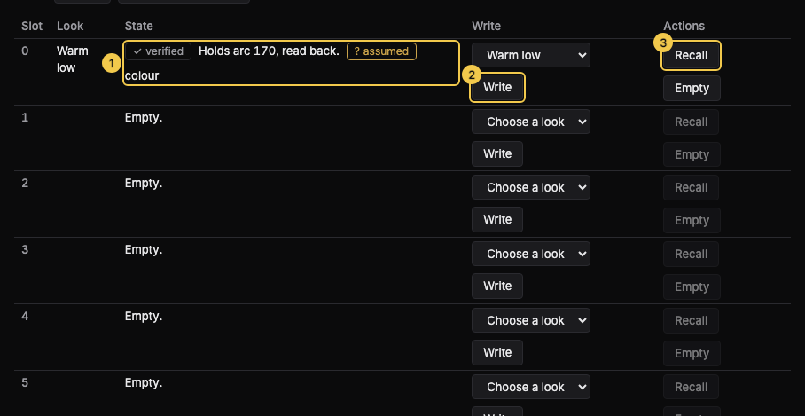
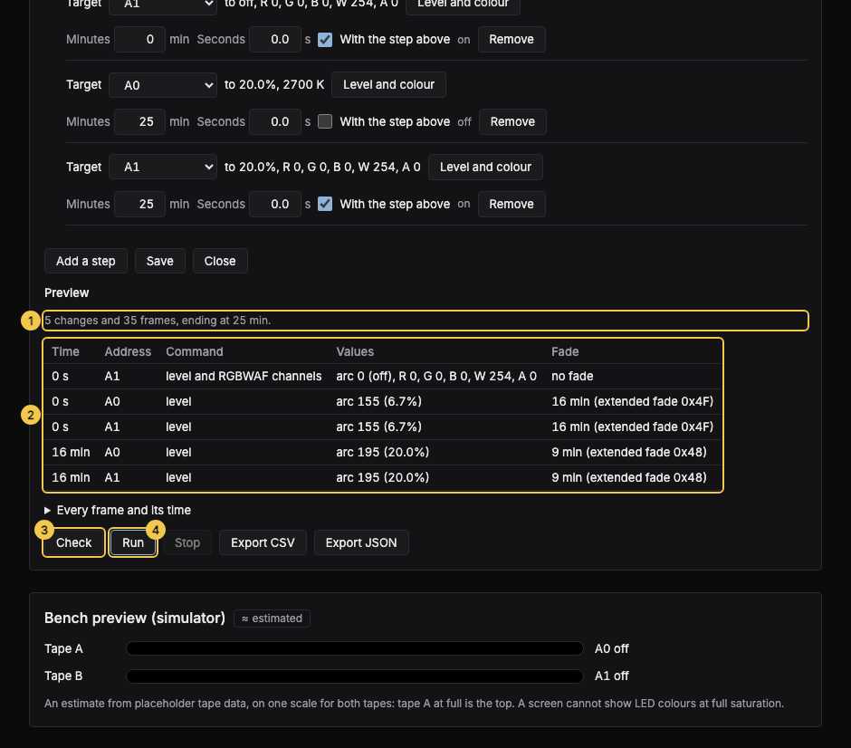
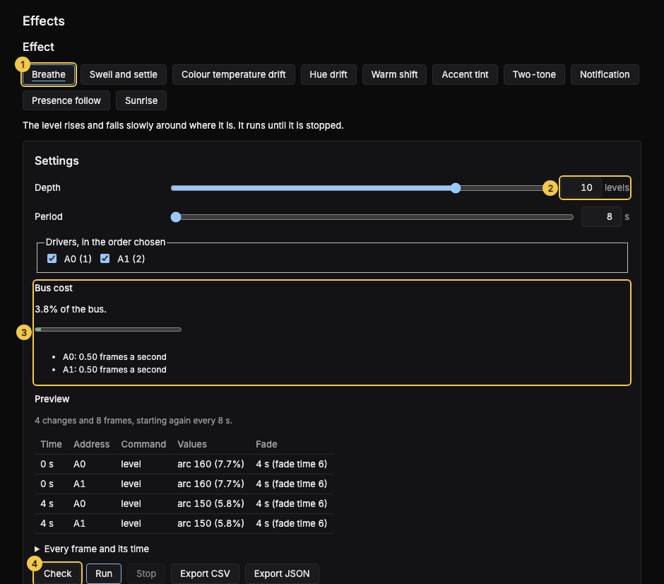

# Looks, sequences and effects

Three ways to keep a piece of lighting design. All are stored in this browser, travel in a workspace file, and reach the lights only through the governor.

|          | Is                                                            | Runs                                                   |
| -------- | ------------------------------------------------------------- | ------------------------------------------------------ |
| Look     | A level, a colour and an optional fade, with a name           | When recalled, from a driver's own scene slot          |
| Sequence | A list of steps: a target, a level and colour, and a duration | Once, on the app's clock, using the driver's own fades |
| Effect   | A built-in pattern with settings                              | Once, or until stopped                                 |

## Looks

| Field  | Values                                               |
| ------ | ---------------------------------------------------- |
| Name   | Up to 60 characters, unique                          |
| Level  | Output % or arc level                                |
| Colour | None, a colour temperature, or RGBWAF channel levels |
| Fade   | None, or one of the driver's fade values             |

A look is not tied to one driver, but a look with a colour fits only drivers that take that kind of colour: writing a colour temperature look to an RGBWAF driver is refused. The editor's "Take what a driver shows now" copies a driver's level and colour into the look. The slot map says, for each driver, which look is in which of its 16 scene slots.

| Action               | Does                                                                    | Sends                                                                |
| -------------------- | ----------------------------------------------------------------------- | -------------------------------------------------------------------- |
| Write                | Stores the look's level and colour in the slot and reads the level back | The colour as a temporary colour, DTR0, SET SCENE, QUERY SCENE LEVEL |
| Recall               | Goes to what the slot holds. A look with a fade sets it first           | SET FADE TIME if needed, then GO TO SCENE                            |
| Empty                | Takes the driver out of the scene                                       | REMOVE FROM SCENE                                                    |
| Read the slots again | Reads all 16 levels                                                     | QUERY SCENE LEVEL, 16 times                                          |

| Slot state             | Means                                                                                                                                                   |
| ---------------------- | ------------------------------------------------------------------------------------------------------------------------------------------------------- |
| Empty                  | The driver holds nothing in it                                                                                                                          |
| Not read yet           | The slot has not been read since the app started                                                                                                        |
| Holds arc n, read back | The driver's level, the level written and the look agree                                                                                                |
| mismatch               | They do not: the look was edited since, or the driver was written from elsewhere. "The driver holds arc n, which no look here wrote" is the second case |
| assumed                | Said of the colour. A stored colour cannot be read back, so the app takes it as written                                                                 |

"Recall on several drivers" sends one recall to every driver or to a group. Each driver goes to what its own slot holds, and a driver whose slot is empty does not change.

## Sequences

| Step field          | Values                                    |
| ------------------- | ----------------------------------------- |
| Target              | A driver, a group, or all                 |
| Level and colour    | As a look                                 |
| Minutes, Seconds    | How long the step takes                   |
| With the step above | Starts with the step before, not after it |

The planner turns each step into one driver fade where a fade fits the duration, and chains fades where none does: 25 minutes becomes 16 and 9. A step that changes nothing sends nothing, which is how a wait is made.

| Control                 | Does                                                                                                        |
| ----------------------- | ----------------------------------------------------------------------------------------------------------- |
| Preview                 | Every change with its time, target, values and fade. "Every frame and its time" lists the frames            |
| Check                   | Runs the plan on a copy of the simulated bench with the governor's own code, and says what would be refused |
| Run, Stop               | Runs it. A plan the governor would refuse does not start                                                    |
| Export CSV, Export JSON | One row for each change: time, address, command, values, fade                                               |

| Built in      | From               | To                  | Over       |
| ------------- | ------------------ | ------------------- | ---------- |
| Night fade-in | Off                | 20% at 2700 K       | 25 minutes |
| Wind down     | Where the light is | 10% at 2700 K       | 10 minutes |
| Night light   | Where the light is | 1% at 2700 K        | 1 minute   |
| Sunrise       | Off, at 2700 K     | 30% at about 4000 K | 30 minutes |

A run times itself on the app's clock and holds a screen wake lock. A long run depends on the browser keeping the page awake. If the page is suspended or the computer sleeps, the run stops keeping time, and the report at the end says so.

## Effects

| Effect                   | Does                                                | Settings                                                                           | Repeats |
| ------------------------ | --------------------------------------------------- | ---------------------------------------------------------------------------------- | ------- |
| Breathe                  | The level rises and falls slowly around where it is | Depth 4 to 12 levels, period 8 to 16 s                                             | Yes     |
| Swell and settle         | A brief rise, then an ease back                     | Overshoot 5 to 10 levels, rise 0.7 to 2 s, settle 2 to 4 s                         | No      |
| Colour temperature drift | A slow wander between warmer and cooler             | Step 10 to 30 mirek, time between steps 20 to 60 s                                 | Yes     |
| Hue drift                | A slow wander in tint, kept pale                    | Amount 5 to 40 channel levels, time between steps 20 to 60 s                       | Yes     |
| Warm shift               | Dims to a level and warms as it goes                | Level 0.5 to 30%, time 2 to 60 s, warmest 1800 to 3000 K, curve linear or filament | No      |
| Accent tint              | White with a small colour offset                    | Strength 3 to 7 steps, hue 0 to 359 degrees, time 0.7 to 4 s                       | No      |
| Two-tone                 | Neighbouring drivers breathe in opposite phase      | Depth 4 to 12 levels, period 8 to 16 s                                             | Yes     |
| Notification             | One or two soft pulses                              | Pulses 1 or 2, depth 5 to 15 levels, rise 0.7 to 1 s, fall 1 to 3 s                | No      |
| Presence follow          | Each driver in turn brightens, then eases back      | Pace 1 to 5 s, boost 5 to 40 levels, rise 0.7 to 1.4 s, hold 1 to 10 s             | No      |
| Sunrise                  | A long rise from off, from warm to cooler           | Length 20 to 40 min, level 5 to 39%, colour temperature 3000 to 5000 K             | No      |

An effect moves around the level a light is at, so a light that is off is turned away with the reason. Sunrise is the reverse: it starts from off, and a light that is on is turned away.

| Effect                               | Needs                                    |
| ------------------------------------ | ---------------------------------------- |
| Colour temperature drift, Warm shift | A driver that takes a colour temperature |
| Hue drift, Accent tint               | RGBWAF channels                          |
| Two-tone                             | An even number of drivers                |

The ranges are narrow on purpose. They are the ranges inside which the rate guard allows the effect, so a setting the sliders offer is one that runs.

| Control                           | Does                                                                      |
| --------------------------------- | ------------------------------------------------------------------------- |
| Drivers, in the order chosen      | Which drivers, and their order for effects that pass from one to the next |
| Bus cost                          | The share of the bus the effect uses, and frames a second for each driver |
| Preview, Check, Run, Stop, Export | As for a sequence. A repeating effect shows and exports one period        |
| Save these settings               | Keeps the effect and its settings under a name                            |

## On hardware

> [!WARNING] Untried on hardware (HW-03)
> On Hardware and Both nothing is checked ahead: the governor judges each change as it is sent. Under the holding rules it allows a recall to one driver with no fade, and it refuses most effects and any sequence that fades colour gear or changes a group.
