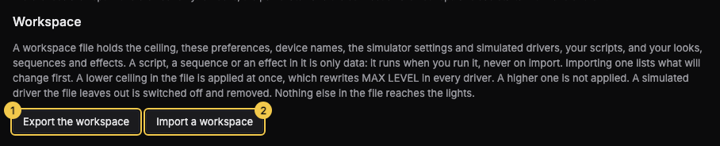

# Files and storage

## Where things are kept

| Thing                                                | Kept                               | Leaves this browser |
| ---------------------------------------------------- | ---------------------------------- | ------------------- |
| Preferences, ceiling, device names                   | This browser                       | In a workspace file |
| Looks, slot map, sequences, effects, scripts, plates | This browser                       | In a workspace file |
| Hallway, mounts, set-up B                            | This browser                       | In a workspace file |
| Console history                                      | This browser                       | No                  |
| Solved light for the visualiser                      | This browser, the last four scenes | No                  |
| Unlocks, the panic latch, the connection             | Nowhere. A reload starts with none | No                  |

The app makes no request to any address but its own. Nothing is sent anywhere.

Anything else that ever ran on `127.0.0.1:47821` in the same browser profile shares this storage, which is why a profile kept for the app is worth having.

## The workspace file

Settings, "Export the workspace" and "Import a workspace". One JSON file, at most 2 MB.

| Key                                     | Holds                                                                                                                            | Limit                                          |
| --------------------------------------- | -------------------------------------------------------------------------------------------------------------------------------- | ---------------------------------------------- |
| `ceiling`                               | An arc level                                                                                                                     | Applied only if lower than the present ceiling |
| `preferences`                           | The Playground's Live or Commit mode, history length, the leading-space rule, verify mode, reduced motion, the visualiser's view |                                                |
| `devices`                               | Address, name, the simulator settings, the light type of a simulated driver                                                      | 64                                             |
| `looks`, `slots`                        | The library and each driver's slot map                                                                                           | 200 looks                                      |
| `sequences`                             | Name and steps                                                                                                                   | 100, of 500 steps each                         |
| `effects`                               | Type and settings                                                                                                                | 100                                            |
| `scripts`                               | Name and text                                                                                                                    | 100                                            |
| `hallway`, `mounts`, `links`, `compare` | The visualiser's set-up, and set-up B                                                                                            | 6 mounts                                       |
| `plates`                                | Style, buttons, mapping, timers                                                                                                  | 8                                              |

## What an import does and does not do

| It does                                                                                                                                                                       | It does not                                          |
| ----------------------------------------------------------------------------------------------------------------------------------------------------------------------------- | ---------------------------------------------------- |
| List what will change, and wait for you to confirm                                                                                                                            | Run a script, a sequence or an effect                |
| Replace looks, sequences, effects, plates and the set-up. Scripts and device names are merged by name: one in the file replaces one of the same name, and the others are kept | Write anything to a driver, with one exception below |
| Apply a lower ceiling at once, which rewrites MAX LEVEL in every driver                                                                                                       | Raise the ceiling                                    |
| Add and remove simulated drivers to match the file                                                                                                                            | Turn verify mode off, or override reduced motion     |
| Refuse a file newer than the app, and migrate an older one                                                                                                                    | Unlock anything                                      |

Every imported file is treated as untrusted: checked for size and shape before use, and never run.

## Other files

| File                            | From                                           | To                                     |
| ------------------------------- | ---------------------------------------------- | -------------------------------------- |
| A script, as text               | Scripts, Export                                | Scripts, Import                        |
| A plan, as CSV or JSON          | Sequences and Effects, Export                  | A spreadsheet. One row for each change |
| Hardware check results, as JSON | Devices, "Show results", then "Save as a file" | A record of the day                    |

A cell in a CSV export that a spreadsheet would read as a formula has a single quote put in front.

## Records set aside

A stored record that fails its checks when the app starts is set aside, not deleted, and listed in Settings. The app starts without it.
