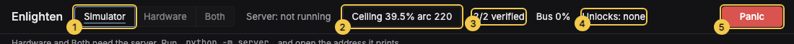
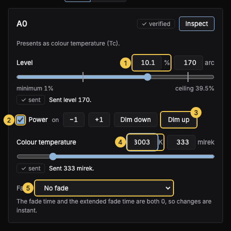
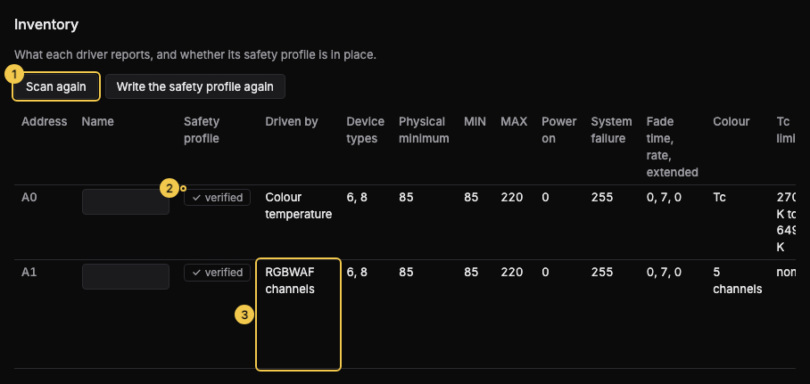
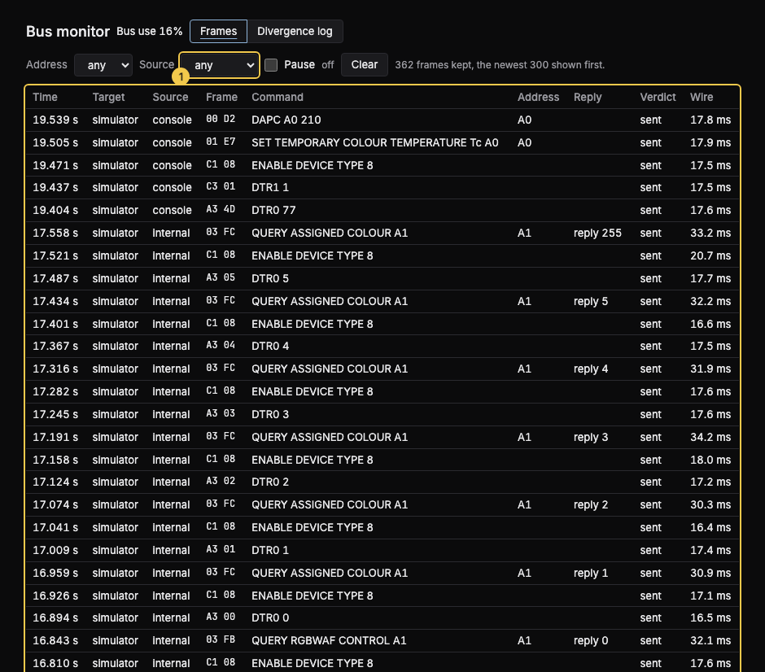

# Pages

Each page of the app, with what its controls do. Keys are in [Keys](../generated/keys.md).

## Top bar

| Control                   | Does                                                                                                     |
| ------------------------- | -------------------------------------------------------------------------------------------------------- |
| Simulator, Hardware, Both | The output target. Changing it stops scripts, sequences and effects first, and sends no level of its own |
| Connection                | "Server: not running" unless the page came from the hardware server                                      |
| Ceiling                   | Opens the ceiling dialog. Shows output % and arc level                                                   |
| n/n verified              | Drivers whose safety profile read back, out of drivers found                                             |
| Bus                       | Share of the last second the bus was busy, as of the last change                                         |
| Unlocks                   | Which unlocks are on. "Lock all" appears when any is                                                     |
| Panic                     | Stops everything and sends every light OFF                                                               |

A banner under the bar carries what needs attention: the panic latch with Resume, a lost connection with Reconnect, a driver that is not verified, a stored ceiling offered back, and how to start the server.

## Playground

Alt 1. One panel for each driver, with the controls that driver reports it can take.

| Control              | Does                                                                                            | Sends                                       |
| -------------------- | ----------------------------------------------------------------------------------------------- | ------------------------------------------- |
| Live, Commit         | Live sends as a control moves. Commit sends nothing until Apply                                 |                                             |
| Level                | Output % and arc level, edited as either. The slider marks the driver's minimum and the ceiling | DAPC                                        |
| Power                | Off, and back to the last level                                                                 | OFF, GO TO LAST ACTIVE LEVEL                |
| -1, +1               | One arc level down or up                                                                        | STEP DOWN, STEP UP                          |
| Dim down, Dim up     | Dims while held                                                                                 | DOWN, UP, repeated                          |
| Colour temperature   | Kelvin and mirek, within the driver's limits                                                    | The Tc sequence, then ACTIVATE or the level |
| Colour, Raw channels | A hue and saturation picker with white and amber sliders, or the channel levels as numbers      | The RGBWAF sequence                         |
| Fade                 | The driver's fade, from the values it has. The line under it says which setting is used and why | SET FADE TIME or SET EXTENDED FADE TIME     |
| Inspect              | Shows this driver's stored values in the inspector                                              |                                             |

Under a control, a line says what was sent, and why if it was clamped or refused. The bench preview at the foot draws both tapes on one scale. It is an estimate from placeholder tape data.

In Live mode a moving level control sends the newest value as soon as the bus and the rate guard allow, as a DAPC sequence so the driver dims smoothly.

## Devices

Alt 2.

| Section            | Holds                                                                                                                                                                                                                        |
| ------------------ | ---------------------------------------------------------------------------------------------------------------------------------------------------------------------------------------------------------------------------- |
| Inventory          | What each driver reports: device types, physical minimum, MIN, MAX, power-on and system failure levels, fades, colour. A name you give it becomes an alias in the console. "Scan again" and "Write the safety profile again" |
| Unlocks            | Choose `rate`, `reset` or `expert`, type its name, Unlock. "Lock all"                                                                                                                                                        |
| Commissioning      | Gives each driver without a short address the lowest free one, then scans and writes the profile. Needs the `reset` unlock and the word typed                                                                                |
| Simulated drivers  | Up to four more DA5-L drivers at addresses 2 to 63, as C2 (tunable white) or C5 (RGB and two whites). Simulator only                                                                                                         |
| Simulator settings | Each behaviour of the DA5-L that is not known, as a setting with a sourced default and the hardware-day test that settles it                                                                                                 |
| Hardware check     | On Hardware and Both: the steps of the first day with hardware, run and recorded                                                                                                                                             |

## Bus monitor

Alt 3.

| Control                | Does                                                                        |
| ---------------------- | --------------------------------------------------------------------------- |
| Frames, Divergence log | Every frame sent, or the differences between simulator and hardware in Both |
| Address, Source        | Filters                                                                     |
| Pause                  | Holds the list still. Frames are still kept                                 |

Each row: time, target, source, the frame in hex, the command, the address, the reply, the verdict (sent, or refused with the reason) and the wire. It keeps 2,000 frames and shows the newest 300.

## Settings

Alt 4.

| Setting                                            | Values                     | Notes                                            |
| -------------------------------------------------- | -------------------------- | ------------------------------------------------ |
| Playground sends                                   | Live, Commit               |                                                  |
| Reduce motion                                      | As the system says, Always |                                                  |
| Console history keeps                              | Lines, 1,000 by default    |                                                  |
| Leave lines that start with a space out of history | Off, on                    |                                                  |
| Verify mode                                        | On, off                    | An expanded history line is shown before it runs |

Below them: export and import of the workspace, records set aside (a stored record that failed its checks, kept and not deleted), and the keys.

Preferences are kept in this browser only. Unlocks, the panic latch and the connection are not kept: a reload starts with none of them.

## Scripts

Alt 5. See [Scripts](scripts.md).

| Control        | Does                                                                                       |
| -------------- | ------------------------------------------------------------------------------------------ |
| The list       | Built-in and saved scripts. `first-light` is built in                                      |
| New, Import    | A new script, or one from a text file                                                      |
| The text       | One command a line. The line under it says whether it parses, with each error and its line |
| Save, Run      | Run runs the saved text, never unsaved text                                                |
| Export, Delete | A text file, or removal after a confirmation                                               |

## Visualiser

Alt 6. See [Visualiser](visualiser.md).

## Looks

Alt 7. See [Looks, sequences and effects](design.md).

| Section                   | Holds                                                                                                                     |
| ------------------------- | ------------------------------------------------------------------------------------------------------------------------- |
| Library                   | Named looks: a level, a colour and an optional fade. Nothing is sent until one is written or recalled                     |
| Slots                     | For the chosen driver, its 16 scene slots: which look is in each, the state, Write, Recall, Empty. "Read the slots again" |
| Recall on several drivers | One slot on every driver or on a group, with an optional fade first                                                       |

## Sequences

Alt 8. Built-in sequences, saved ones, and an editor of steps with a preview of every change before it runs.

## Effects

Alt 9. Ten effects, their settings as sliders, the drivers they go to, the bus cost and a preview.

## Switches

Alt 0. See [Switches](switches.md).

## Manual

F1. This manual. The inspector is hidden here to give the text the width.
