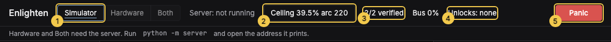

# Safety

Everything that reaches a simulated or real driver goes through one governor: the playground, the console, raw frames, scripts, sequences, effects, switches and imports. It applies four things, in this order of weight.

| Control            | What it is                                                                               | Can it be loosened                                                  |
| ------------------ | ---------------------------------------------------------------------------------------- | ------------------------------------------------------------------- |
| Panic              | Stops everything and sends every light OFF                                               | No. Nothing delays or refuses it                                    |
| Rate guard         | Limits how fast and how far light may swing, because flashing light can trigger seizures | Slightly, with the `rate` unlock. Never above three swings a second |
| Verified gear      | Most commands go only to a driver whose stored safety values were written and read back  | No                                                                  |
| Brightness ceiling | A comfort limit on level, held by the app and written to each driver                     | Yes, by a deliberate action                                         |

## Panic

| Way                         | Where it works                                             |
| --------------------------- | ---------------------------------------------------------- |
| The Panic button            | Top bar, on every page. No dialog and no console covers it |
| Escape, twice within 500 ms | Anywhere, an open dialog or the console included           |
| `panic`                     | The console                                                |

Panic empties the queue, stops every script, sequence and effect, and sends TERMINATE and then OFF to every address. The app is then latched: the top bar shows "Panic latched", a banner says so, and nothing is sent until you choose Resume or type `resume`. Resuming sends nothing.

> [!WARNING] Untried on hardware (HW-01)
> On hardware the OFF is meant to be on the bus within 100 ms of the key press when the bus is idle. That time has been measured against the fake hasseb only.

If the page hangs, the bus worker stops every runner after 3 seconds without a heartbeat from a visible page. On hardware the server also turns the lights off when the page goes away or falls silent for 3 seconds.

## Rate guard

| Rule                 | Limit                                                               | Scope                      |
| -------------------- | ------------------------------------------------------------------- | -------------------------- |
| Swings               | One swing starts in any second, by default                          | Each address, and the room |
| Hard steps           | One in any 2 seconds for an address, one in any second for the room | No unlock changes this     |
| Small changes        | Three reversals a second                                            | Each address, and the room |
| Repeating pattern    | Faster than one swing in 2 seconds stops after 5 seconds            |                            |
| RESET, when unlocked | One in any 10 seconds                                               |                            |

A swing is two opposite legs. A leg is a run of light in one direction whose ends differ by a ratio of 1.10 or more, or that starts or ends at off. A hard step is a leg with a ratio above 2, or to or from off, made with no fade of 0.7 s or longer. Ordinary switching on and off is allowed. Hard flashing is held to one change every 2 seconds.

The guard judges what the light is predicted to do, whatever kind of command causes it. It watches each colour channel and an estimate of luminance, so a swap between colours at a constant level counts. A move to or from saturated red counts as a leg.

When the guard holds a console line it prints `waiting`, the time and the reason, and sends the line when the guard allows, up to 10 seconds. Ctrl-C ends the wait. A sequence or effect that would break a rule is refused when it is planned, with the rule.

## Verified gear

On connect, after commissioning and after any RESET, the app writes a safety profile to each driver and reads every value back.

| Stored value         | Set to                                                           | Why                                                        |
| -------------------- | ---------------------------------------------------------------- | ---------------------------------------------------------- |
| MAX LEVEL            | The ceiling                                                      | The driver itself then holds the ceiling                   |
| POWER ON LEVEL       | 0                                                                | The tape stays off when power returns                      |
| SYSTEM FAILURE LEVEL | 255 (no change)                                                  | The tape does not jump if the bus fails                    |
| MIN LEVEL            | Lowered to the physical minimum, only if it is above the ceiling | So MAX LEVEL can be set                                    |
| Dimming curve        | Checked, not written: it must be the standard curve              | A linear curve would make an arc level mean far more light |

A driver is verified only when every read-back matches. The top bar counts verified drivers, and each driver shows one of three states.

| State    | Meaning                                                                   |
| -------- | ------------------------------------------------------------------------- |
| verified | MAX LEVEL matches the ceiling and the profile read back                   |
| pending  | A write is on its way, or not read back yet                               |
| mismatch | A value read back differently. The Devices page shows expected and actual |

An unverified driver accepts DAPC, OFF, queries and DTR writes only. `profile` shows the state, `profile apply` or Re-apply profile in the inspector writes it again.

> [!WARNING] Untried on hardware (HW-02)
> Two lines of the profile rest on behaviour the DA5-L has not been seen to have: that POWER ON LEVEL 0 keeps the tape off, and that a warm colour stored with it is the colour it starts with. The inspector marks both "not yet confirmed on hardware".

## Brightness ceiling

|                  |                                                                                                                                           |
| ---------------- | ----------------------------------------------------------------------------------------------------------------------------------------- |
| Default          | 40%, stored as arc level 220 (39.5%)                                                                                                      |
| Set as           | Output %, rounded down to an arc level. The control shows both                                                                            |
| Lowering         | At once. The governor uses it for the next command, MAX LEVEL is rewritten in every verified driver, and any tape above it is turned down |
| Raising          | You confirm by typing the new value. A script, sequence, effect, switch or imported file cannot raise it                                  |
| Lowest           | A driver's physical minimum. Lower is refused, with the lowest value that driver can hold                                                 |
| Colour gear      | The arc level times the sum of the channel levels is held to the ceiling. Only the app can hold this part                                 |
| A level above it | Sent as the ceiling, and the reply says `clamped`                                                                                         |

Open it from the Ceiling button in the top bar, or use `cap` in the console: `cap` shows it, `cap 30%` or `cap 200` sets it.

The ceiling is a comfort feature, not the safety control. It holds on the ordinary paths. RESET is the known way round it: RESET sends a driver to full output and puts MAX LEVEL back to 254, so it is blocked by default.

## Unlocks

An unlock lasts until the page reloads or you lock it. You type its name to confirm. A script cannot unlock.

| Unlock   | Allows                                                                                     | Still limited by                                                                                         |
| -------- | ------------------------------------------------------------------------------------------ | -------------------------------------------------------------------------------------------------------- |
| `rate`   | The swing limit to be 2 or 3 a second, with swing starts at least 360 ms apart             | Never more than 3. Hard steps are unchanged                                                              |
| `reset`  | RESET, addressing and the search commands, from a person                                   | RESET goes to one short address, is followed by OFF and the profile, and is limited to one in 10 seconds |
| `expert` | Commands that store colour limits, gear features or a dimming curve, each with a read-back | A person only                                                                                            |

`unlock <name>` and `lock [<name>]` in the console, or the Devices page. "Lock all" in the top bar drops every unlock.

> [!NOTE] Not yet in the app
> The `rate` unlock is accepted, but version 0.2.0 has no control that then sets the swing limit to 2 or 3.

## On hardware

Until real gear has been tried, the Hardware and Both targets hold to stricter rules.

| Rule                                                                        | Effect                                                                                                                     |
| --------------------------------------------------------------------------- | -------------------------------------------------------------------------------------------------------------------------- |
| One change of light every 2 seconds to an address                           | OFF included                                                                                                               |
| A change of light goes to one short address                                 | To a group or to all, only OFF is allowed                                                                                  |
| Colour before level on colour gear                                          | A level alone is refused while the app does not know which colour the driver holds. `tc` and `rgb` send them in that order |
| No fades on colour, or on a level to colour gear                            | Fade time and extended fade time must read back as 0                                                                       |
| No UP, DOWN, CONTINUOUS UP, CONTINUOUS DOWN or DAPC sequence to colour gear |                                                                                                                            |
| A fade setting counts only as read back                                     |                                                                                                                            |

> [!WARNING] Untried on hardware (HW-03)
> These rules exist because the DA5-L's fades, read-backs and colour changes have not been observed. Each is to be relaxed, or kept, by what the first day with hardware shows.

The refusal always names the rule. `help hardware` prints this list in the console.
