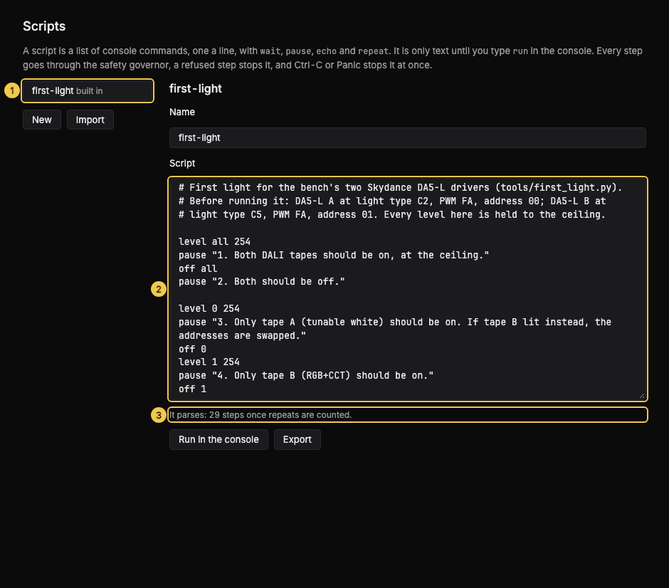

# Scripts

A script is text: one console command a line. It is data for the console and is never run as code.

## Format

| Line                   | Does                                                              |
| ---------------------- | ----------------------------------------------------------------- |
| any console command    | Runs it, except those listed below                                |
| `wait <time>`          | Waits. Ctrl-C ends it                                             |
| `pause "message"`      | Shows the message and waits for Enter                             |
| `echo <text>`          | Prints the text, marked as echoed                                 |
| `repeat <n>` ... `end` | Repeats the lines between, 1 to 1,000 times, nested twice at most |
| `# text`               | A comment                                                         |

Not allowed in a script: `unlock`, `lock`, `target`, `run`, `history`, `clear`, `use`, `resume`, `scripts`, `explain`, `manual`, and `cap` with a value above the present ceiling.

| Limit                       | Value          |
| --------------------------- | -------------- |
| Size                        | 64 kB          |
| Lines                       | 2,000          |
| Line length                 | 500 characters |
| Steps, with repeats counted | 10,000         |

## Running

| Step                                    | Notes                                                    |
| --------------------------------------- | -------------------------------------------------------- |
| `run <name>` or Run on the Scripts page | The saved text runs. Unsaved text in the editor does not |
| Each step is shown                      | With `+` and its line number, before it runs             |
| At a `pause`                            | Enter goes on. The console's header has Go on and Stop   |
| A refused step                          | Stops the script and reports the line                    |
| To stop                                 | Ctrl-C in the console, Stop, or panic                    |

A script is checked whole before anything runs: if a line does not parse, nothing runs. It runs in the background on the app's own clock, and the page holds a screen wake lock while it does.

A script cannot unlock anything or raise the ceiling, so an imported script can do no more than you could by typing its lines with no unlocks on.

## Built in

`first-light` walks the bench through its first check: both tapes on and off, each alone, warm and cool white on tape A, each colour and white on tape B. Every level in it is held to the ceiling.

```console
scripts
run first-light
```



## Files

Import takes a text file. Export writes one. A script also travels in a workspace file. Importing never runs a script.
