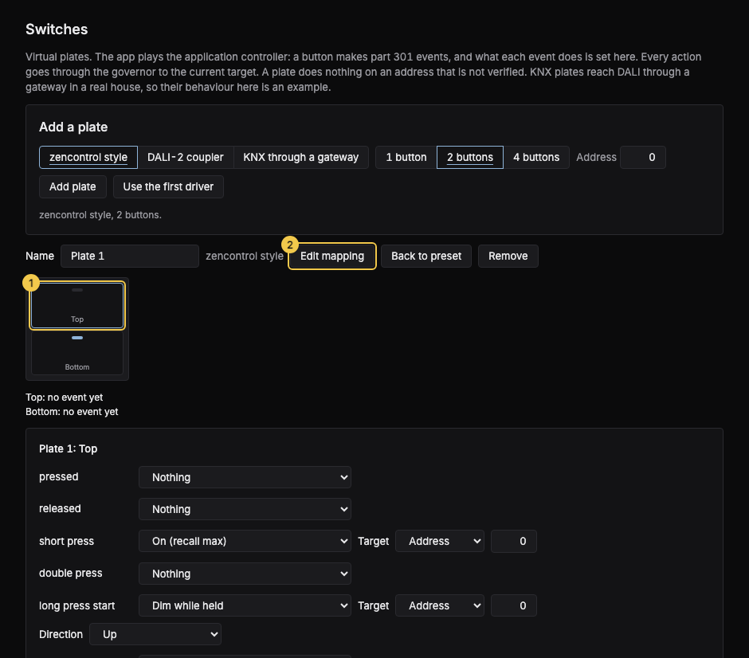

# Switches

Virtual wall plates. The app plays the application controller: a button makes the events a DALI-2 input device makes, and a mapping says what each event does. Every action goes through the governor to the current target and shows in the console.

## A plate

| Choice  | Values                                                            |
| ------- | ----------------------------------------------------------------- |
| Style   | zencontrol style, DALI-2 coupler, KNX through a gateway           |
| Buttons | 1, 2 or 4                                                         |
| Address | The driver the preset aims at. "Use the first driver" fills it in |

Up to 16 plates. A plate is drawn plainly, with no maker's marks. A KNX plate reaches DALI through a gateway in a real house, so its behaviour here is an example.

## Pressing

Mouse, touch and keyboard all work. Space, held, holds a button.

| Event                          | When                                                            |
| ------------------------------ | --------------------------------------------------------------- |
| pressed, released              | At once                                                         |
| short press                    | Released within the short timer                                 |
| double press                   | Two short presses within the double timer, if that timer is on  |
| long press start, repeat, stop | Held past the short timer, then at each repeat, then on release |
| stuck, free                    | Held past the stuck timer, then released                        |

| Timer  | Default | Range                           |
| ------ | ------- | ------------------------------- |
| Short  | 500 ms  | 20 to 5,100 ms                  |
| Double | Off     | 0 to 2,000 ms                   |
| Repeat | 160 ms  | 100 to 2,000 ms, in steps of 20 |
| Stuck  | 20 s    | 5 to 255 s                      |

## Mapping

"Edit mapping" opens, for each button, what each event does.

| Action                      | Does                                                                                   |
| --------------------------- | -------------------------------------------------------------------------------------- |
| Nothing                     |                                                                                        |
| On, Off                     | Recall max, or off                                                                     |
| Toggle                      | Off if it is on. If it is off, to the last active level or to the max level, as chosen |
| Recall a slot               | GO TO SCENE for one of the 16 slots, as on the Looks page                              |
| Dim while held              | Up, down, or the other way at each hold                                                |
| Warmer or cooler while held | On a tunable white driver. Warmer, cooler, or the other way at each hold               |
| Run                         | A sequence or an effect, by name                                                       |
| Stop                        | Stops the sequence or effect that is running                                           |

Each action has a target: an address, a group or all. "Back to preset" restores the style's own mapping.

A plate's actions are indirect level commands, so a plate bound to a driver that is not verified does nothing and says why. A hold's repeats stop on release, on stuck, on panic and on a change of target.

## The light on a button

Off, on when the target is on, on when it is off, or always on.
