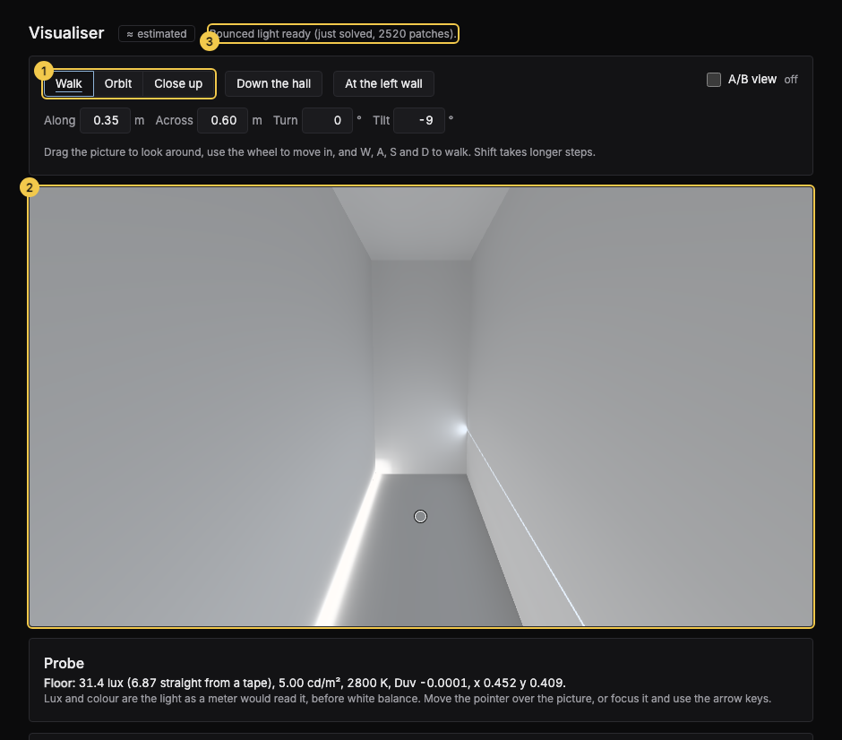
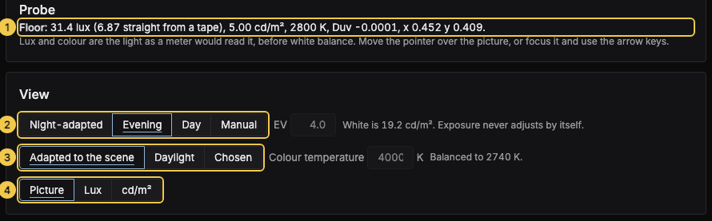
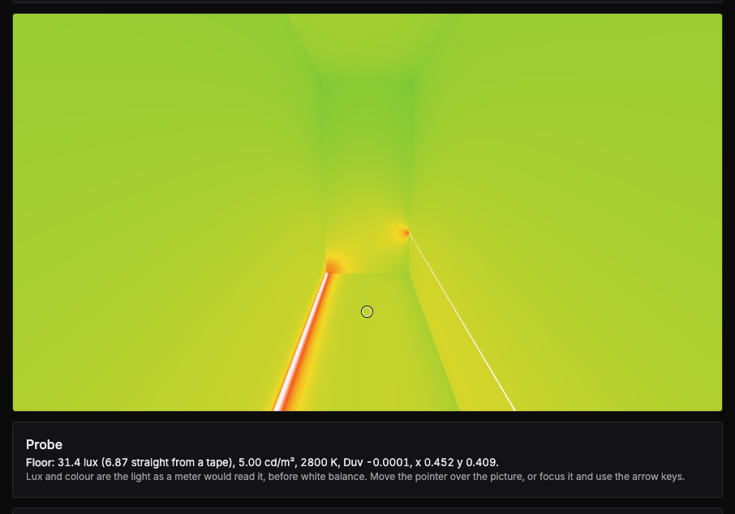
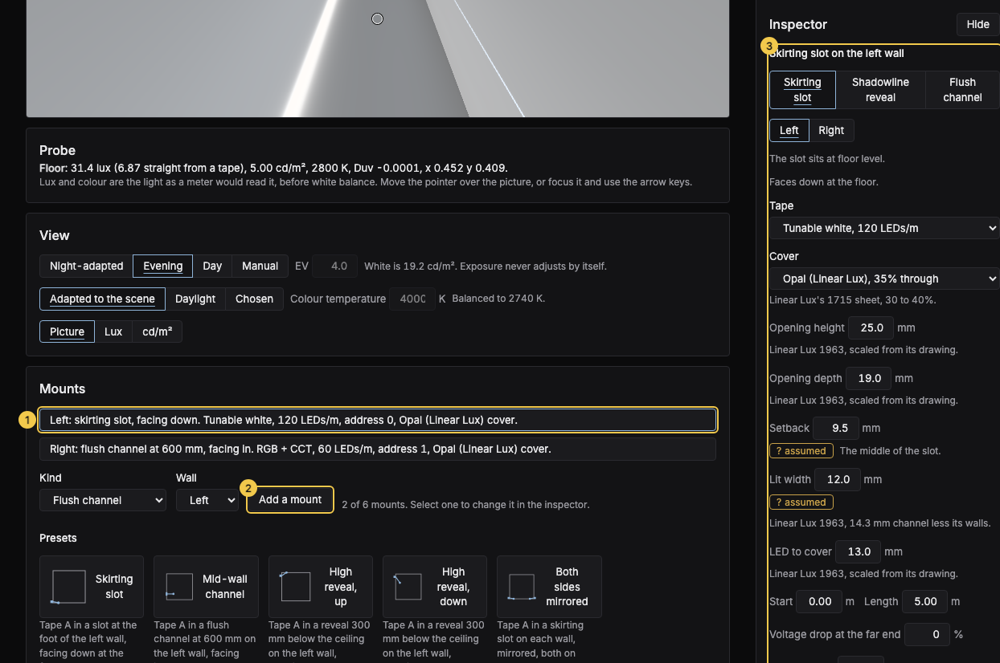

# Visualiser

A rendered hallway that follows the drivers. It is a best-effort estimate of how the light might look, not a measurement: tape output and colour are placeholders until the tapes are measured, and surfaces are taken as neutral and matte. On Simulator the picture is labelled "estimated", and on Hardware and Both "prediction".

## Camera

| Control                         | Does                                                                     |
| ------------------------------- | ------------------------------------------------------------------------ |
| Walk, Orbit, Close up           | Eye-level walk, a view from outside, or close on a mount to see LED dots |
| Down the hall, At the left wall | Preset views                                                             |
| Along, Across, Turn, Tilt       | The camera as numbers                                                    |
| Drag, wheel                     | Look around, move in or out                                              |
| W, A, S, D                      | Walk a quarter metre. A metre with Shift                                 |

## Probe

The light at the point under the pointer, as a meter would read it, before white balance: lux, how much of it came straight from a tape, cd/m2, colour temperature, Duv and chromaticity. The arrow keys move it when the picture has focus.

## View

| Control             | Values                                                                | Notes                                                                          |
| ------------------- | --------------------------------------------------------------------- | ------------------------------------------------------------------------------ |
| Exposure            | Night-adapted (EV 0), Evening (EV 4), Day (EV 7), Manual (-4 to 12)   | It never changes by itself. The line beside it says how bright white is        |
| White balance       | Adapted to the scene, Daylight, Chosen (2,000 to 10,000 K)            | "Adapted" follows the room's mixed light, so a saturated colour stays a colour |
| Picture, Lux, cd/m2 | The rendered picture, or false colour over four decades with a legend | Lux from 0.1, cd/m2 from 0.01                                                  |

A screen cannot show LED colours at full saturation. The page says which display colour space is in use.

## Mounts

A mount is a tape in a place. Up to six. Select one in the list to change it in the inspector.

| Setting                                                    | Values                                                                                              |
| ---------------------------------------------------------- | --------------------------------------------------------------------------------------------------- |
| Kind                                                       | Skirting slot, Shadowline reveal, Flush channel                                                     |
| Wall                                                       | Left, Right. "Mirror on the other wall" keeps a pair alike                                          |
| Height, direction                                          | A channel's height (600 mm by default), a reveal's height and whether it faces up, down or both     |
| Tape                                                       | One of three: tunable white at 120 LEDs/m, RGB + CCT at 60 LEDs/m, or COB tunable white             |
| Cover                                                      | None, clear, frosted, opal (market typical), opal (Linear Lux), each with a transmission and a blur |
| Opening height and depth, setback, lit width, LED to cover | The profile's dimensions, in mm                                                                     |
| Start, Length                                              | Where the tape runs along the hall                                                                  |
| Voltage drop at the far end                                | A percentage                                                                                        |
| DALI address                                               | The driver the mount follows                                                                        |

Each default says where it came from: a maker's drawing, or "assumed". A mount on an address with no driver draws unlit and says so. On Hardware and Both, a mount on a driver that exists in the simulator only says "simulated only".

Presets replace the mounts and keep the hallway: skirting slot, mid-wall channel, high reveal up, high reveal down, both sides mirrored.

## Hallway

| Setting               | Range                            | Default                                                                     |
| --------------------- | -------------------------------- | --------------------------------------------------------------------------- |
| Length                | 1 to 12 m                        | 5 m                                                                         |
| Width                 | 1.0 to 1.5 m                     | 1.2 m                                                                       |
| Height                | 2.4 to 3.0 m                     | 2.7 m                                                                       |
| End walls             | Closed, Open                     | Closed                                                                      |
| Ceiling, Walls, Floor | A named finish, or a reflectance | Vivid White (0.90), Natural White (0.80), Light microcement (0.50, assumed) |

## A/B view

Two set-ups side by side, driven by the same drivers, with one exposure and one white balance. "Editing" chooses which of Set-up A and Set-up B the controls change, and "Copy A to B" starts B from A. Use it to compare a cover, a height or a tape.

## Timing

A change on the bus shows in the next frame drawn. A change to the hallway or a mount is solved again, which takes up to 2 seconds for one mount. Solved light is kept for the four scenes used most recently.

> [!WARNING] Untried on hardware (HW-07)
> Brightness and colour in the picture come from placeholder tape data. Until lux is measured at the wall for each tape, the lux and cd/m2 figures are estimates of the right order, not values to design to.
